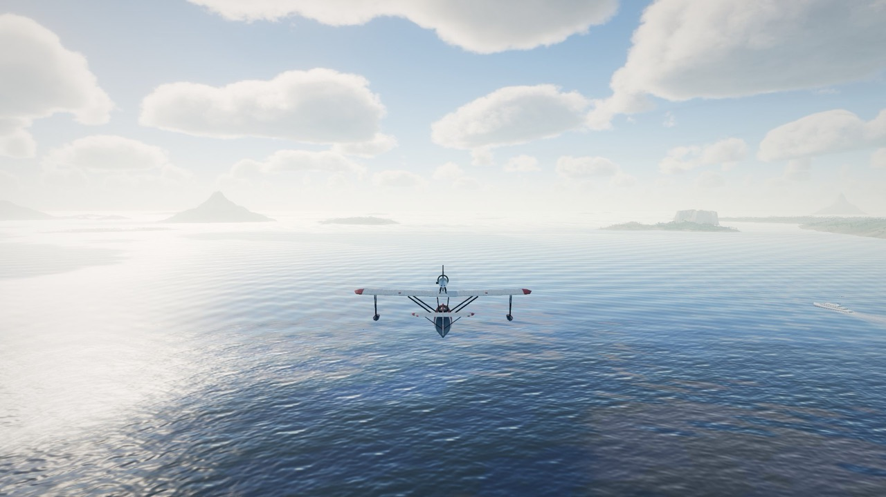
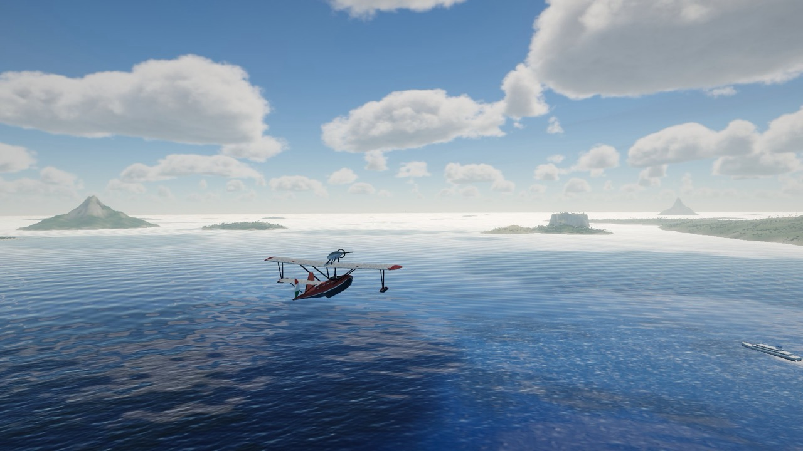
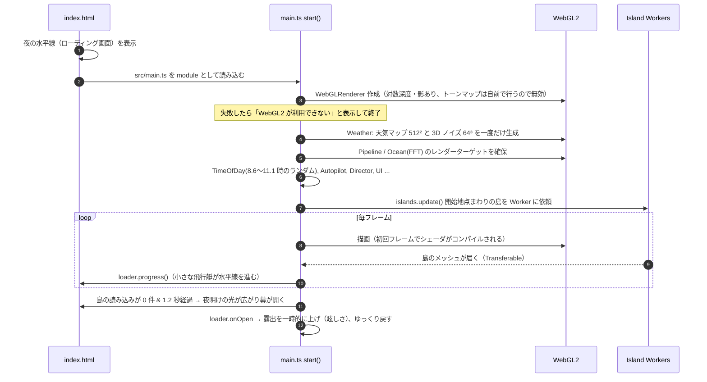

# 1. 概要と技術スタック

[← 目次](README.md) ｜ [次へ：アーキテクチャ →](02-architecture.md)

## 何を作っているか

アプリの名前は **「風の航路」** です。操作の要らない「動く風景画」です。1930 年代風の小さな飛行艇が、手続き的に生成された地中海の群島の上を自動操縦で飛び続けます。時間帯・雲・光・カメラワークは自動で移ろい、ユーザーは眺めるだけです（時間帯やカメラを切り替えることもできます）。

| 朝                             | 昼                           |
| ------------------------------ | ---------------------------- |
|  |   |
| **光芒（雲の天井）**           | **夜（月の道と村の灯り）**   |
|   |  |

> 名前は「風の航路」に統一しています（ページタイトル、README、`package.json` の `description`）。npm のパッケージ名には日本語が使えないので、`package.json` の `name` とフォトモードで保存する PNG のファイル名だけはローマ字の `kaze-no-koro` です。

## 技術スタック

| 分類        | 使っているもの                                             | 役割                                                                                                    |
| ----------- | ---------------------------------------------------------- | ------------------------------------------------------------------------------------------------------- |
| 言語        | TypeScript 7（`tsc --noEmit` で型チェックのみ）            | すべてのロジック。GLSL はテンプレート文字列として `.ts` に埋め込み                                      |
| 3D          | [three.js](https://threejs.org/) 0.186（唯一の実行時依存） | WebGL2 レンダラ、シーングラフ、標準マテリアル、影、PMREM、LOD、InstancedMesh                            |
| シェーダ    | GLSL ES 3.0                                                | 空、雲、海、FFT、ポストプロセス、鳥、夜の灯りなど。three.js 標準マテリアルにも `onBeforeCompile` で注入 |
| 並列化      | Web Worker（ES module worker）                             | 島のメッシュと小物配置の生成                                                                            |
| ビルド      | Vite 8                                                     | 開発サーバー（ポート 5287）、本番ビルド（`target: es2023`）                                             |
| Lint / 整形 | Oxlint / Oxfmt                                             | Rust 製の高速な linter / formatter                                                                      |
| ツール管理  | mise（Node.js 24 / pnpm 12）                               | `mise.toml` でバージョン固定                                                                            |

**アセットはゼロ** です。テクスチャ画像も glTF も使わず、以下をすべてコードで作っています。

- 空・雲・海の見た目 → GLSL のシェーダ（物理ベースの近似）
- 雲のノイズ・天気マップ → 起動時に GPU で一度だけ生成
- 島の地形 → 解析的な高さ関数 + ノイズ（Worker でメッシュ化）
- 機体・船・木・家・灯台 → `BufferGeometry` を手で組み立て、模様は `<canvas>` に描いたテクスチャ
- 起動時のローディング画面 → HTML と CSS のアニメーションのみ

## ディレクトリ構成

```
3d-plane-opus5.5-v2/
├─ index.html              ローディング画面（夜の水平線）と UI の CSS。main.ts を読み込む
├─ package.json            依存は three のみ。dev / build / lint / format スクリプト
├─ vite.config.ts          ポート 5287、Worker を ES module で出力
├─ tsconfig.json
├─ mise.toml               Node.js 24 / pnpm 12
├─ .claude/launch.json     開発サーバーの起動設定
└─ src/
   ├─ main.ts              起動処理とフレームループ（全体の指揮者）
   ├─ core/
   │  ├─ math.ts           damp（フレームレート非依存の減衰）、Spring、wobble（揺らぎ）
   │  └─ noise.ts          CPU 側のハッシュ・PRNG・Perlin・fbm・ridged（島や天気の判定に使用）
   ├─ env/                 「環境」：時間・大気・天気
   │  ├─ time.ts           時刻の進み方、太陽と月の方向、時間帯プリセット
   │  ├─ atmosphere.ts     CPU 側の単一散乱大気。太陽色・環境光・露出を計算
   │  └─ weather.ts        天気マップと 3D ノイズを GPU で生成。CPU コピーで雲の有無を判定
   ├─ flight/              飛ぶ・撮る
   │  ├─ autopilot.ts      自動操縦（島めぐり・高度帯・雲の通過・地形回避・突風）
   │  ├─ director.ts       標準カメラ（ゆっくり移ろう構図）とフォトモード
   │  └─ cinema.ts         シネマモード（カットを切るオートディレクション）
   ├─ render/              描画の基盤
   │  ├─ pipeline.ts       マルチパスのレンダリングパイプライン
   │  ├─ globals.ts        全シェーダで共有するユニフォーム G
   │  ├─ fsq.ts            全画面三角形 1 枚で描くパス（FullscreenPass）
   │  ├─ worldMaterial.ts  three.js 標準マテリアルに雲の影・風・窓の灯りを注入
   │  └─ shaders/
   │     ├─ common.ts      共通 GLSL（ノイズ、大気定数、LUT 参照、雲の密度場）
   │     ├─ sky.ts         Sky-view LUT 生成、空ドーム（太陽・月・星・巻雲）
   │     ├─ clouds.ts      雲の影マップ、ボリュームレイマーチ、時間方向の蓄積
   │     ├─ ocean.ts       海面の頂点・フラグメントシェーダ
   │     ├─ noisegen.ts    タイル可能な 3D ノイズと天気マップの生成
   │     └─ post.ts        合成（空気遠近）、ブルーム、トーンマップ
   ├─ world/               世界に置くもの
   │  ├─ ocean.ts          海のメッシュ（放射状グリッド）とゲルストナー波・航跡の設定
   │  ├─ oceanFFT.ts       GPU の FFT 海洋（3 カスケード）
   │  ├─ islands/
   │  │  ├─ terrain.ts     島の種類と高さ関数（メインスレッドと Worker で共有）
   │  │  ├─ builder.ts     メッシュ・頂点色・木・家・灯台・桟橋の生成
   │  │  ├─ worker.ts      builder を Worker で動かす薄いラッパ
   │  │  └─ manager.ts     ストリーミング、LOD、小物、高さマップ
   │  ├─ plane.ts          飛行艇のモデル（ロフト船体・翼・エンジン・尾翼）
   │  ├─ boats.ts / boatModels.ts  船の往来とモデル
   │  ├─ birds.ts          カモメ（InstancedMesh + 頂点シェーダで羽ばたき）
   │  ├─ traffic.ts        ときどき遠くを飛ぶ別の飛行機
   │  ├─ nightLights.ts    夜の小さな灯り（窓・港・灯台・航海灯）をまとめて描くポイント群
   │  └─ props.ts          木・家・屋根・灯台・塔・桟橋のジオメトリ
   └─ ui/
      ├─ ui.ts             控えめな操作 UI とキーボードショートカット
      └─ loader.ts         ローディング画面の進行と開幕演出
```

各ディレクトリの責務は「`env` が世界の状態（時刻・光・天気）を決め、`world` がそれを受けて物を置き、`flight` が飛行と撮影を決め、`render` が絵にする」という分担です。

## 起動の流れ



起動時刻は朝 8.6〜11.1 時のランダムです。開発用の URL パラメーターで挙動を変えられます。

| パラメーター | 効果                                           |
| ------------ | ---------------------------------------------- |
| `?t=17.5`    | 開始時刻を指定                                 |
| `?instant`   | ローディングの演出を省略して即表示             |
| `?scale=1`   | 描画解像度を固定（適応解像度を止める。0.3〜1） |

## 実行方法

```bash
mise install
```

```bash
pnpm install
```

```bash
pnpm dev
```

`http://localhost:5287` で開きます。本番ビルドは `pnpm build`（型チェック → Vite ビルド）です。

---

[← 目次](README.md) ｜ [次へ：アーキテクチャ →](02-architecture.md)
