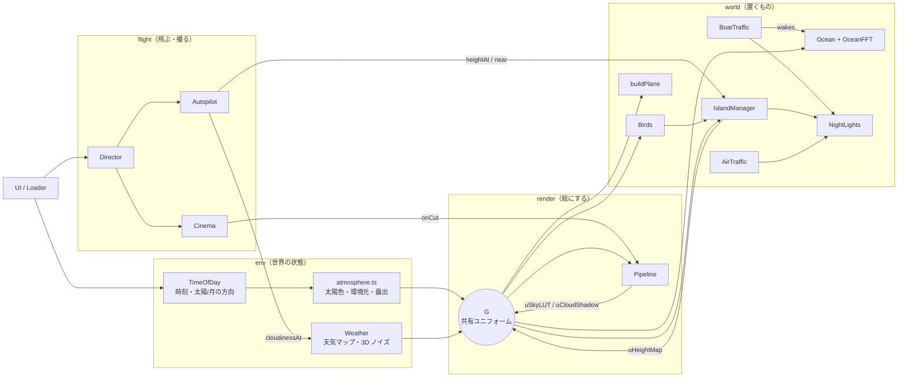
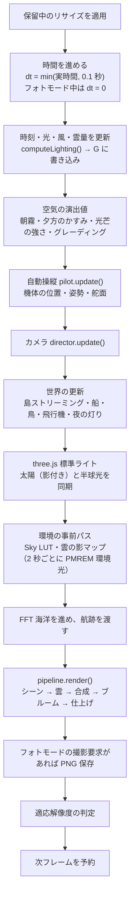

# 2. アーキテクチャとフレームループ

[← 前へ：概要](01-overview.md) ｜ [目次](README.md) ｜ [次へ：レンダリングパイプライン →](03-render-pipeline.md)

## モジュールの関係

`main.ts` の `start()` がすべてのオブジェクトを生成し、毎フレームの順番を決める「指揮者」です。クラス同士は直接ほとんど呼び合わず、**状態の受け渡しは `main.ts` と共有ユニフォーム `G` に集約** されています。



`IslandManager` は「世界の地図係」でもあり、自動操縦・カメラ・船・鳥はみな `islands.heightAt(x, z)` と `islands.near(x, z, r)` で地形を問い合わせます。同様に `Weather.cloudinessAt(x, y, z)` が「CPU から見た雲の地図」で、自動操縦とカメラが雲を避けたり狙ったりするのに使います。

## 1 フレームの処理順（`main.ts` の `frame()`）



順番には意味があります。

1. **光を先に決める**：雲・海・島のシェーダはすべて `G.uSunDir` や `G.uSunColor` を読むので、描画より前に確定させます。
2. **機体 → カメラの順**：カメラは機体の新しい位置を追うので、自動操縦の後に更新します。
3. **島は機体の位置で更新**：カメラではなく `pilot.position` を中心にストリーミングします。
4. **撮影は描画と同じタスクで**：WebGL のキャンバスは描画後に表示されるとバッファが消えるため、`render()` の直後に `canvas.toBlob()` を呼びます（`preserveDrawingBuffer` を使わずに済みます）。

### 時間の扱い

```ts
// main.ts
const rawDt = Math.min(timer.getDelta(), import.meta.env.DEV && document.hidden ? 0.6 : 0.1);
const dt = photo ? 0 : rawDt; // 世界の時間（フォトモードで止まる）
const lightDt = rawDt; // 光の時間（止めた世界でも時間帯ボタンで光だけ変えられる）
```

- 1 フレームの最大ステップを 0.1 秒に制限し、タブ復帰時などに世界がワープしないようにしています。
- フォトモードでは世界の `dt` を 0 にし、光の変化（露出の追従など）だけ `rawDt` で進めます。
- 開発時はタブが隠れても `setTimeout(60ms)` で回り続けるようにしています（自動テストツールのため）。

### 滑らかさを支える小さな道具（`core/math.ts`）

この作品の動きはほぼすべて、次の 3 つの関数で「目標値へなめらかに寄せる」ことで作られています。

| 関数                                  | 式                                     | 使いどころ                                                                                     |
| ------------------------------------- | -------------------------------------- | ---------------------------------------------------------------------------------------------- |
| `damp(cur, target, λ, dt)`            | `cur + (target − cur)·(1 − e^(−λ·dt))` | 露出、旋回率、高度変化、ロールなど。フレームレートに依存しない指数減衰                         |
| `Spring.update(target, halfLife, dt)` | 臨界減衰バネ（速度を保持）             | 標準カメラの構図遷移。止まる直前まで速度が連続するので「いつ動き出したか分からない」動きになる |
| `wobble(t, seed)`                     | 周波数が非整数比の正弦波 4 つの和      | 機体の蛇行、乱気流、カメラの呼吸。周期が見えない 1 次元ノイズ                                  |

## 共有ユニフォーム `G`

`src/render/globals.ts` の `G` は、シェーダのユニフォームオブジェクトを **参照のまま** 共有するための入れ物です。three.js では `uniforms: { uTime: G.uTime }` のように同じオブジェクトを渡すと、`G.uTime.value` を 1 か所で書き換えるだけで全マテリアルに反映されます。

```ts
// globals.ts（抜粋）
export const G = {
  uTime: { value: 0 },
  uSunDir: { value: new THREE.Vector3(0, 1, 0) },   // 主光源（昼は太陽、夜は月）
  uSunColor: { value: new THREE.Color(1, 1, 1) },   // 主光源の放射輝度
  uWind: { value: new THREE.Vector2(6, 2) },        // m/s
  uCloudOffset: { value: new THREE.Vector2(0, 0) }, // 雲の累積ドリフト（m）
  uCloudShadow: { value: null },                    // 雲の影マップ
  uSkyLUT: { value: null },                         // 空の LUT
  uHeightMap: { value: null },                      // 島の高さマップ
  // ...
};
// 必要なものだけ選んで渡す（参照は共有のまま）
uniforms: { ...globalsFor("uTime", "uSunDir", "uWind"), uOwn: { value: 1 } }
```

| ユニフォーム                                         | 書き込む場所                 | 主な読み手                                             |
| ---------------------------------------------------- | ---------------------------- | ------------------------------------------------------ |
| `uTime`                                              | main.ts                      | 波、雲の発達、星のまたたき、木の揺れ、灯りのちらつき   |
| `uSunDir` / `uSunColor` / `uTrueSunDir` / `uMoonDir` | main.ts（`computeLighting`） | 空、雲、海、鳥、合成。`uSunDir` は夜には月の方向になる |
| `uAmbZenith` / `uAmbHorizon`                         | main.ts                      | 雲の環境光、海の本体色、鳥、泡                         |
| `uWind` / `uCloudOffset`                             | main.ts                      | 雲の流れ、巻雲の筋、海の突風、木の揺れ、鳥の漂い       |
| `uCloudCover` / `uDeck` / `uCirrus`                  | main.ts                      | 雲の量、光芒モードの雲の天井、巻雲の量                 |
| `uCloudShadow` / `uCloudShadowFrame`                 | Pipeline                     | 海・島・機体・鳥の直射光、光芒                         |
| `uSkyLUT`                                            | Pipeline                     | 空ドーム、海の反射、空気遠近                           |
| `uHeightMap` / `uHeightFrame`                        | IslandManager                | 海（浅瀬・泡・波の減衰）                               |
| `uWeather` / `uNoise3D`                              | Weather                      | 雲の密度場（影マップ、レイマーチ、海の雲反射）         |
| `uExposure`                                          | main.ts                      | ブルームの抽出、最終トーンマップ                       |

**ひとつの風** が雲・海・木・鳥・機体・帆に共通して効いているのは、この仕組みのおかげです。風向きと風速自体も、ゆっくりした正弦波の組み合わせで数十分かけて変化します。

```ts
const windA = 0.6 + Math.sin(elapsed * 0.0041) * 0.7 + Math.sin(elapsed * 0.0107) * 0.25;
const windS = 6.5 + Math.sin(elapsed * 0.013 + 1) * 2.5; // 4〜9 m/s
G.uWind.value.set(Math.cos(windA) * windS, Math.sin(windA) * windS);
G.uCloudOffset.value.addScaledVector(G.uWind.value, dt * 1.6); // 雲は風下へ流れる
```

GLSL 側の名前は `shaders/common.ts` の `GLOBALS_GLSL` で同じ名前を宣言しており、コメントにも「`globals.ts` と名前をそろえること」と書かれています。

## 座標系と単位

| 項目       | 内容                                                                                                                                                                 |
| ---------- | -------------------------------------------------------------------------------------------------------------------------------------------------------------------- |
| 単位       | 1 = 1 メートル（大気計算だけはキロメートル）                                                                                                                         |
| 軸         | `y` が上、海面は `y = 0`。太陽の計算では `+x` を東、`+z` をおおむね南とみなす                                                                                        |
| 機体の向き | `heading` は `forward = (sin h, 0, cos h)`。ローカル座標は `+z` が機首、`+y` が上、翼は `x` 方向                                                                     |
| 深度       | `logarithmicDepthBuffer: true`。手前 1 m から 60 km 先（カメラの far）まで Z ファイティングなしで描ける。後段のパスでは `exp2(d · log2(far+1)) − 1` で線形距離に戻す |
| 色空間     | シーンは線形 HDR（HalfFloat）。three.js のトーンマップは切り、最終パスで ACES と sRGB 変換を自前で行う                                                               |

### カメラについてくるもの

世界は無限に続きますが、次のものは **カメラ（または機体）に追従** していて、常に足元にあります。

- 空ドーム（半径 40 km の球、毎フレーム `sky.position = camera.position`）
- 海のメッシュ（放射状グリッドの中心がカメラの真下）
- 雲の影マップ（24 km 四方、テクセル単位にスナップしてちらつき防止）
- 島の高さマップ（14 km 四方、機体が 1.4 km 動いたら描き直す）
- 太陽の影カメラ（機体の周り 22 m 四方だけ。機体の自己影用）

---

[← 前へ：概要](01-overview.md) ｜ [目次](README.md) ｜ [次へ：レンダリングパイプライン →](03-render-pipeline.md)
