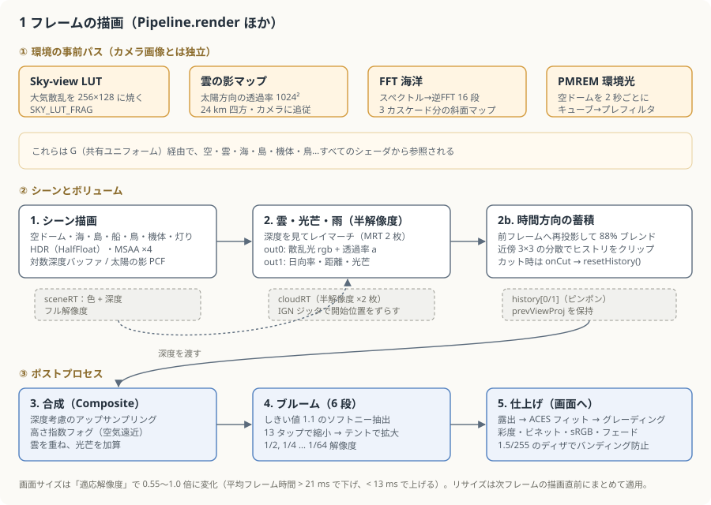
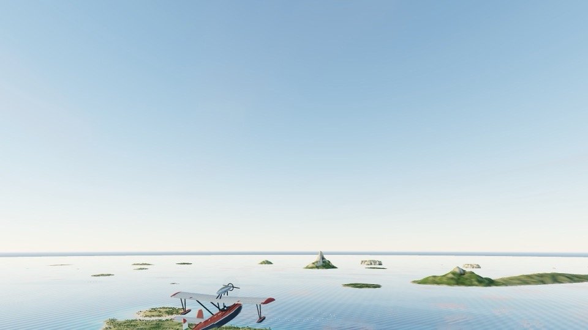
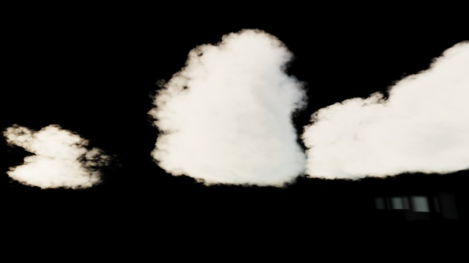
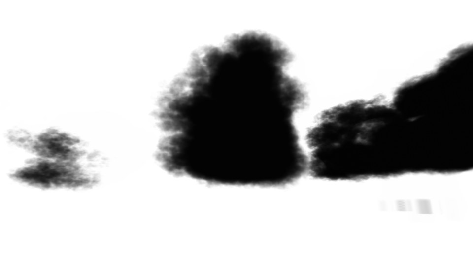
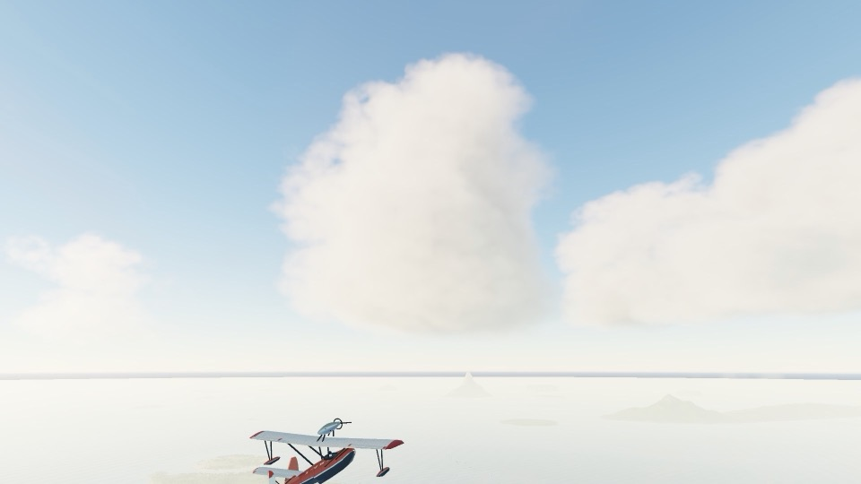
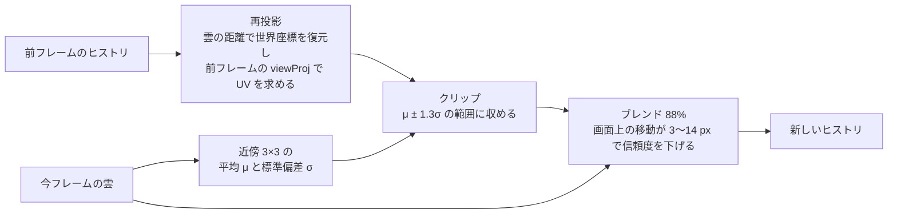

# 3. レンダリングパイプライン

[← 前へ：アーキテクチャ](02-architecture.md) ｜ [目次](README.md) ｜ [次へ：空・大気・時間と光 →](04-sky-and-light.md)

three.js の `renderer.render(scene, camera)` は 1 回だけ呼び、その前後を自作のフルスクリーンパスで固めた構成です。実装は `src/render/pipeline.ts`。



## パスごとの画像

実際のフレームから各レンダーターゲットを読み出したものです（HDR を簡易トーンマップして表示）。

| 1. シーン（雲なし・霧なし）                | 2. 雲のレイマーチ結果（散乱光）      |
| ------------------------------------------ | ------------------------------------ |
|          |       |
| **2. 雲の透過率（白＝空が透ける）**        | **3. 合成（空気遠近 + 雲）**         |
|  |  |

**5. 仕上げ（ブルーム・ACES・グレーディング・ビネット）**


シーン単体では空が青く遠景がくっきりしていますが、合成で「その方向の地平線の空色」に溶ける霧（空気遠近）がかかり、雲が重なります。最後のトーンマップで色が締まり、四隅が少し落ちます。

## FullscreenPass ― 全画面パスの部品

ポストプロセスや LUT の生成は、すべて `src/render/fsq.ts` の `FullscreenPass` で行います。

```ts
// 画面を覆う「大きな三角形 1 枚」。四角形 2 枚より対角線上の無駄なピクセルが出ない
geometry.setAttribute(
  "position",
  new THREE.Float32BufferAttribute([-1, -1, 0, 3, -1, 0, -1, 3, 0], 3),
);
```

`RawShaderMaterial`（GLSL3）に任意のフラグメントシェーダを差し込み、`render(renderer, target)` でレンダーターゲット（または画面）に描くだけの小さなクラスです。`Weather` のノイズ生成、`OceanFFT` のバタフライ演算もこれを使っています。

## レンダーターゲット一覧

| 名前                 | サイズ      | 形式                                       | 内容                                         |
| -------------------- | ----------- | ------------------------------------------ | -------------------------------------------- |
| `skyLUT`             | 256 × 128   | RGBA16F、横方向リピート                    | 方向 → 空の放射輝度                          |
| `cloudShadow`        | 1024 × 1024 | RGBA16F                                    | 地表から太陽方向への雲の透過率（24 km 四方） |
| `sceneRT`            | 画面        | RGBA16F、**MSAA ×4**、Float 深度テクスチャ | シーン本体                                   |
| `cloudRT`            | 画面の 1/2  | RGBA16F × **2 枚（MRT）**                  | 雲・光芒・雨の結果                           |
| `history[0/1]`       | 画面の 1/2  | RGBA16F × 2 枚                             | 時間方向に蓄積した雲（ピンポン）             |
| `compRT`             | 画面        | RGBA16F                                    | 合成後の HDR                                 |
| `bloomDown/Up[0..5]` | 1/2 〜 1/64 | RGBA16F                                    | ブルームのミップチェーン                     |

画面サイズが変わると `setSize()` で全部作り直します。

## 1. シーン描画

`sceneRT` に通常の three.js のシーンを描きます。描かれるものは次のとおりです。

- 空ドーム（`renderOrder = -10`、深度テスト・書き込みなし。いちばん奥）
- 海（独自の `ShaderMaterial`）
- 島・木・家・灯台（`MeshStandardMaterial` を `patchWorldMaterial` で拡張）
- 船、鳥（`InstancedMesh`）、他の飛行機、夜の灯り（`Points`）
- 機体（太陽の `DirectionalLight` で 2048² の PCF 影を落とす。影カメラは機体まわり 22 m）

環境光は 2 種類あります。

- `HemisphereLight`：空の天頂色と地平線色から毎フレーム設定
- `scene.environment`：空ドームと暗い海だけの小さなシーンを `PMREMGenerator.fromScene()` で 2 秒ごと（時間帯を切り替えた直後は 0.4 秒ごと）に焼き直した IBL。金属的なエンジンカウルや窓ガラスに空が映る

## 2. 雲・光芒・雨（半解像度）

`CLOUD_MARCH_FRAG` が `sceneRT` の深度を読みながら、画面の半分の解像度でボリュームをレイマーチします。出力は 2 枚（MRT）。

| 出力   | r                            | g                  | b                      | a            |
| ------ | ---------------------------- | ------------------ | ---------------------- | ------------ |
| `out0` | 雲の散乱光 R                 | G                  | B                      | 透過率 T     |
| `out1` | 視線上の日向率（光芒の明暗） | 雲までの距離（km） | シーンまでの距離（km） | 光芒の散乱量 |

詳しい中身は [5 章：雲](05-clouds.md) で説明します。ここで大事なのは、**シーンの深度より奥は数えない** ことと、**ステップの開始位置をピクセルとフレームごとにずらす**（Interleaved Gradient Noise + 黄金比）ことです。1 フレームだけ見るとノイズだらけですが、次の時間方向の蓄積で消えます。

### 2b. 時間方向の蓄積（`CLOUD_TEMPORAL_FRAG`）

TAA（テンポラル・アンチエイリアス）と同じ考え方です。



- 再投影に使う距離は、雲があればその雲の重み付き平均距離、なければシーンの距離（最大 30 km）。
- 分散クリップ（variance clipping）で、ヒストリが現在の近傍から外れていたら引き戻します。これで雲の縁の残像が出ません。
- シネマモードでカメラが **カット** したときは `director.cinema.onCut = () => pipeline.resetHistory()` で履歴を捨て、前のカットの雲がにじまないようにしています。

## 3. 合成（`COMPOSITE_FRAG`）

### 深度を考慮したアップサンプリング

半解像度の雲を全解像度に戻すとき、単純な双線形補間だと **機体や島の輪郭に雲がにじみます**。そこで 2×2 の近傍それぞれについて「そのテクセルが見ていたシーン距離（`out1.b`）」と「このピクセルのシーン距離」を比べ、距離が近いテクセルほど重みを大きくします（バイラテラルフィルタ）。

```glsl
float dd = abs(a.b - min(distKm, 1000.0)) / max(min(distKm, 1000.0), 0.05);
float w = bw * (1.0 / (1e-3 + dd * 8.0)) + 1e-5;   // bw は通常の双線形の重み
```

### 空気遠近（高さ指数フォグ）

空気の密度が高さとともに指数的に薄くなると仮定すると、視線上の光学的厚さは閉じた式で積分できます。

```glsl
// 密度 ρ(y) = exp(−y / H) を、カメラから距離 d まで積分
float fogOD(vec3 ro, vec3 rd, float d, float H) {
  float a = exp(-max(ro.y, 0.0) / H);
  float k = rd.y / H;
  if (abs(k) < 1e-5) return a * d;
  return a * (1.0 - exp(-k * d)) / k;
}
```

- 霧の色は「その方向の地平線付近の空（Sky LUT）」＋「太陽の方向に強い前方散乱のかすみ」。だから遠くの島は空の色に溶けていきます。
- 減衰係数は `vec3(0.85, 0.95, 1.12) × uFogDensity` と青を少し強くしており、遠景がわずかに青みがかります。
- 霧の濃さ `fogDensity` は `main.ts` で時刻から決めています（朝霧・夕方の金色のかすみ・夜は少し濃い・雲の天井の下では薄い）。
- 雲自体にも雲の距離でフォグをかけるので、遠くの雲ほど空に溶けます。

最終的な合成式は「シーン（霧あり）× 雲の透過率 ＋ 雲（霧あり）＋ 光芒」です。

## 4. ブルーム

ゲームでよく使われる「13 タップ縮小 + テント拡大」のミップチェーン型ブルームです（SIGGRAPH 2014 の Call of Duty: Advanced Warfare の発表で広まった方式）。

1. **Prefilter**：4 タップで 1/2 に縮小しつつ、露出をかけた輝度がしきい値 1.1 を超える部分を「ソフトニー」で抽出（急に切れないように 2 次曲線でつなぐ）。蛍（1 ピクセルだけ極端に明るい点）対策に 60 で頭打ち。
2. **Down**：13 タップのフィルタで 1/4、1/8 … 1/64 まで 6 段。
3. **Up**：3×3 のテントフィルタで拡大しながら、1 段上の縮小結果に足し戻す。

強さは昼 0.05、夜 0.1。夜は月のきらめきや村の灯りがふんわり光ります。

## 5. 仕上げ（`FINAL_FRAG`）

```
HDR × 露出 + ブルーム
  → ACES フィット（Stephen Hill の近似）
  → シャドウとハイライトで別々の色味（グレーディング）
  → 彩度
  → ビネット（四隅を 1 − 0.55·r² だけ暗く）
  → sRGB へ変換
  → フェード（起動時の黒からの開幕）
  → ±0.75/255 のディザ（グラデーションの縞を消す）
```

グレーディングの色は時刻で変わります（`main.ts`）。夕方はハイライトを暖色に、夜はシャドウを青に寄せ、夜は彩度を下げます。

```ts
pipeline.gradeShadows.set(0.97 + dusk * 0.02, 0.99, 1.03 + time.night * 0.05);
pipeline.gradeHighlights.set(1.02 + dusk * 0.04, 1.0, 0.98 - dusk * 0.03);
pipeline.saturation = 1.08 - time.night * 0.2;
```

---

[← 前へ：アーキテクチャ](02-architecture.md) ｜ [目次](README.md) ｜ [次へ：空・大気・時間と光 →](04-sky-and-light.md)
