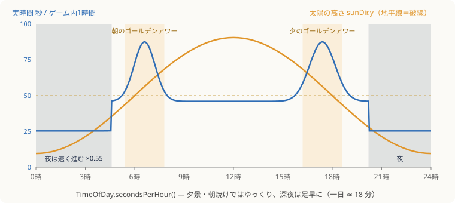
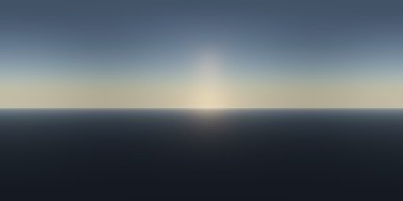
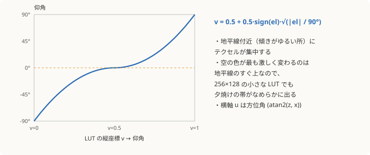
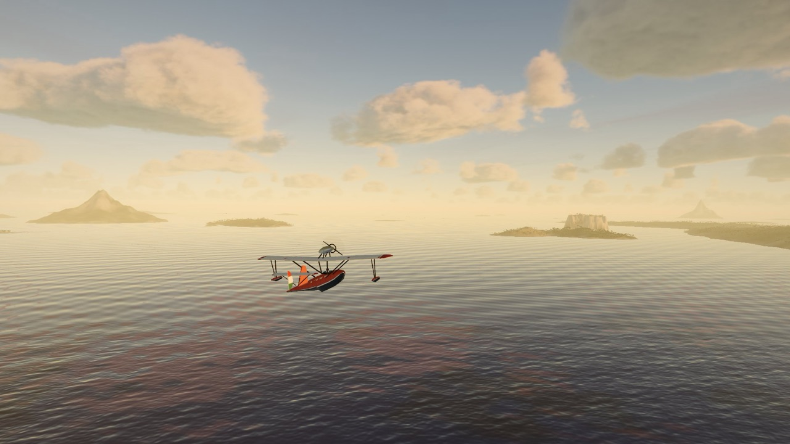

# 4. 空・大気・時間と光

[← 前へ：レンダリングパイプライン](03-render-pipeline.md) ｜ [目次](README.md) ｜ [次へ：雲 →](05-clouds.md)

関係するファイル：`src/env/time.ts`、`src/env/atmosphere.ts`、`src/render/shaders/sky.ts`、`src/render/shaders/common.ts`（`ATMOSPHERE_GLSL`, `SKY_LUT_GLSL`）

## 時間の流れ（`TimeOfDay`）

「移ろい」モードでは一日が約 18 分で巡ります。ただし一定速度ではなく、**夕景と朝焼けではゆっくり、深夜は足早に** 進みます。



```ts
private secondsPerHour(h: number): number {
  const golden = Math.max(
    Math.exp(-Math.pow((h - 17.4) / 1.1, 2)),   // 夕方 17.4 時を中心にしたガウス
    Math.exp(-Math.pow((h - 6.6) / 0.9, 2)),    // 朝 6.6 時
  );
  const night = h > 20.2 || h < 4.6 ? 1 : 0;
  return 46 * (1 + golden * 0.9) * (night ? 0.55 : 1);
}
```

時間帯ボタン（朝・昼・光芒・夕・夜）を押したときは、目標時刻へ **前向きに** 時間を早送りします（`d < 0` なら 24 時間足して必ず未来へ進む）。巻き戻さないので、夜→朝なら夜明けを経由して自然に明けていきます。

| モード | 時刻     | 特徴                                           |
| ------ | -------- | ---------------------------------------------- |
| 朝     | 7.1 時   | 低い太陽、朝霧                                 |
| 昼     | 12.6 時  | 高い太陽                                       |
| 光芒   | 7.7 時   | 低い朝日 + 切れ間のある雲の天井（`uDeck = 1`） |
| 夕     | 17.62 時 | 金色の光、かすみ                               |
| 夜     | 23.2 時  | 月の道、星、灯り                               |

### 太陽と月の向き

太陽は 6 時に東の地平線から昇り、南寄りの空を最大仰角 64° まで通って 18 時に沈む単純な円軌道です。月は 19.3 時ごろに昇り、最大 36° と低めにして **海面に月の光の道ができる** ようにしています。

```ts
const th = ((this.hours - 6) / 12) * Math.PI;
this.sunDir.set(Math.cos(th), Math.sin(th) * Math.sin(se), Math.sin(th) * Math.cos(se)).normalize();
```

`night` は太陽の高さから `1 − smoothstep(−0.2, 0.02, sunDir.y)` で求め、星・灯り・グレーディングの切り替えに使います。

## 大気散乱モデル

空の色は「単一散乱」のレイマーチで計算しています。大気を半径 6360 km の地球を包む 60 km の殻とみなし、3 種類の粒子を考えます。

| 成分                 | 散乱係数（/km）                              | スケールハイト                            | 効果                                        |
| -------------------- | -------------------------------------------- | ----------------------------------------- | ------------------------------------------- |
| レイリー（空気分子） | R 5.8e-3, G 13.6e-3, B 33.1e-3               | 8 km                                      | 波長の短い青ほど強く散乱 → 青空、夕焼けの赤 |
| ミー（エアロゾル）   | 散乱 2.4e-3, 消散 2.7e-3                     | 1.25 km                                   | 太陽のまわりの白い輝き（前方散乱 g = 0.78） |
| オゾン               | R 0.65e-3, G 1.88e-3, B 0.085e-3（吸収のみ） | 高度 25 km を中心に厚さ ±15 km の三角分布 | 薄明の空の青紫                              |

視線上のある点 `q` で太陽光が散乱して目に届く量は、

```
L = ∫ T(カメラ→q) · T(q→太陽) · [β_R·ρ_R(h)·P_R(θ) + β_M·ρ_M(h)·P_M(θ)] dt
```

- `T` は透過率（`exp(−光学的厚さ)`）
- `ρ(h) = exp(−h / H)` は高さ `h` での密度
- `P_R` はレイリーの位相関数 `3/(16π)·(1+cos²θ)`、`P_M` は Cornette–Shanks 型のミー位相関数

GPU 側（`SKY_LUT_FRAG`）は視線方向に 24 ステップ、各点から太陽へ 8 ステップで積分します。ステップは `t = tMax·(i/N)²` と二次で配置し、密度の高いカメラ近くを細かく刻んでいます。さらに安価な多重散乱の近似（等方的な定数項）と、地平線の向こうで急に暗くならないための「柔らかい地球の影」を足しています。

### CPU 側の同じモデル（`atmosphere.ts`）

同じ定数を使った CPU 版で、毎フレーム数方向だけ評価して次の値を作ります。

| 値                      | 求め方                                                 | 使い道                                        |
| ----------------------- | ------------------------------------------------------ | --------------------------------------------- |
| `sunColor`              | 高度 200 m から太陽方向の透過率 × 強度 22 × 夕日の色味 | 太陽円盤、直射光                              |
| `mainDir` / `mainColor` | 太陽が地平線下に沈むと月へクロスフェード               | `G.uSunDir` / `G.uSunColor`（夜は月が主光源） |
| `skyZenith`             | 天頂と斜め上 2 方向の空の放射輝度の加重和              | 上向きの環境光                                |
| `skyHorizon`            | 水平線付近 4 方位の平均                                | 横向きの環境光、霧の色の基準                  |
| `exposure`              | `1.38 / √(シーンの代表輝度)`（0.05〜12 に制限）        | 自動露出                                      |

夜でも真っ暗にならないよう、環境光と空に深い青の「床」を足しています。

```ts
// 夕日には物理計算より少しだけ金色を足す
export function sunTint(y: number, out: THREE.Color) {
  const k = THREE.MathUtils.smoothstep(y, 0.02, 0.38);
  return out.setRGB(1.0, 0.8 + 0.2 * k, 0.58 + 0.42 * k);
}
```

## Sky-view LUT

空の散乱計算は重いので、毎フレーム **256×128 の小さなテクスチャ（LUT）に一度だけ焼き**、あとは全員がそれを引きます。



_横軸が方位角、縦軸が仰角（上が天頂、中央が地平線、下半分は地平線より下）。太陽のある方位が明るい。_

縦方向は仰角を素直に割り当てず、平方根でゆがめています。



```glsl
// 方向 → LUT の UV（common.ts の SKY_LUT_GLSL）
vec2 skyLutUv(vec3 d) {
  float az = atan(d.z, d.x);
  float el = asin(clamp(d.y, -1.0, 1.0));
  float v = 0.5 + 0.5 * sign(el) * sqrt(abs(el) / 1.5707963);
  return vec2(az / 6.2831853 + 0.5, v);
}
```

この LUT を使う場所：

- **空ドーム**：方向で LUT を引くだけ
- **海の反射**：反射ベクトルで LUT を引く
- **空気遠近**：霧の色に「その方向の地平線付近の空」を使う
- **PMREM 環境光**：空ドームを描いて焼くので間接的に LUT が反映される

すべて同じ LUT なので、**空と海の映り込みと霧の色が必ず一致** します。

## 空ドーム（`SKY_DOME_FRAG`）

半径 40 km の球を裏側から描き、LUT の上に次のものを重ねます。

| 要素     | 実装                                                                                                                |
| -------- | ------------------------------------------------------------------------------------------------------------------- |
| 太陽円盤 | `dot(d, sunDir)` が 0.99996 を超える範囲を `smoothstep` で縁取り、さらに `pow(cos, 900)` のコロナ                   |
| 月       | 円盤内を月面座標に変換し、fbm で「海（暗い部分）」の模様。`pow(cos, 1200)` と `pow(cos, 40)` の 2 段の光暈          |
| 巻雲     | 高度 9 km の平面と視線の交点で、**風向きに引き伸ばした** fbm の筋。ドメインワープで筋をうねらせ、地平線近くでは消す |
| 星       | 方向を立方体の 6 面に投影し、2 つの密度のグリッドにハッシュで星を配置。まばたきは時間の正弦波。夜だけ表示           |

```glsl
// 巻雲：風の向きの座標系に回して、縦横で周波数を変えて「筋」にする
vec2 wd = normalize(uWind + vec2(1e-3, 0.0));
vec2 q = vec2(dot(p, wd), dot(p, vec2(-wd.y, wd.x)));
float warp = fbmValue(q * vec2(0.00004, 0.00009) + 3.0);
float streak = fbmValue(vec2(q.x * 0.00004, q.y * 0.00016 + warp * 2.2));
```

巻雲の量 `uCirrus` は数十分周期で増減し、光芒モードの雲の天井が出ている間は消えます。

## 時刻に応じた「空気」の演出

`main.ts` では、物理計算とは別に時刻ごとの雰囲気を足しています。

```ts
const morning = Math.exp(-Math.pow((h - 7) / 1.6, 2)); // 7 時を中心に
const dusk = Math.exp(-Math.pow((h - 18) / 1.5, 2)); // 18 時を中心に
pipeline.fogDensity =
  (0.62e-4 + morning * 0.9e-4 + dusk * 0.35e-4 + time.night * 0.3e-4) * (1 - deck * 0.35);
```

| 朝（朝霧）                   | 夕（金色のかすみ）           | 夜（月の道）               |
| ---------------------------- | ---------------------------- | -------------------------- |
|  |  |  |

ローディング画面が開いた瞬間は露出を 2.8 倍にして「目が慣れていない眩しさ」を演出し、`glare *= exp(−0.55·dt)` で数秒かけて戻します。

---

[← 前へ：レンダリングパイプライン](03-render-pipeline.md) ｜ [目次](README.md) ｜ [次へ：雲 →](05-clouds.md)
