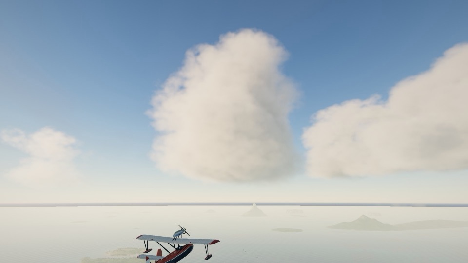
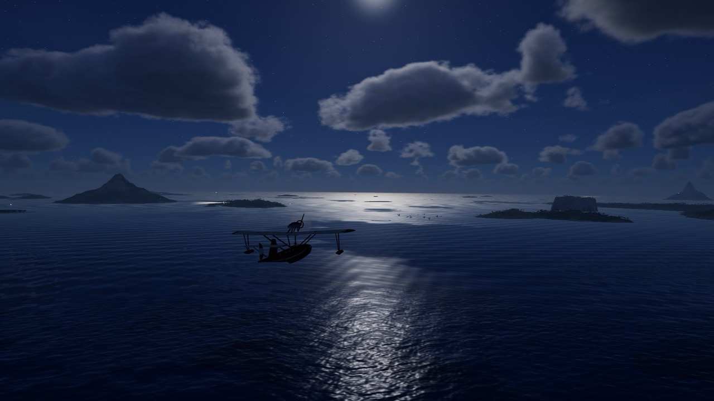
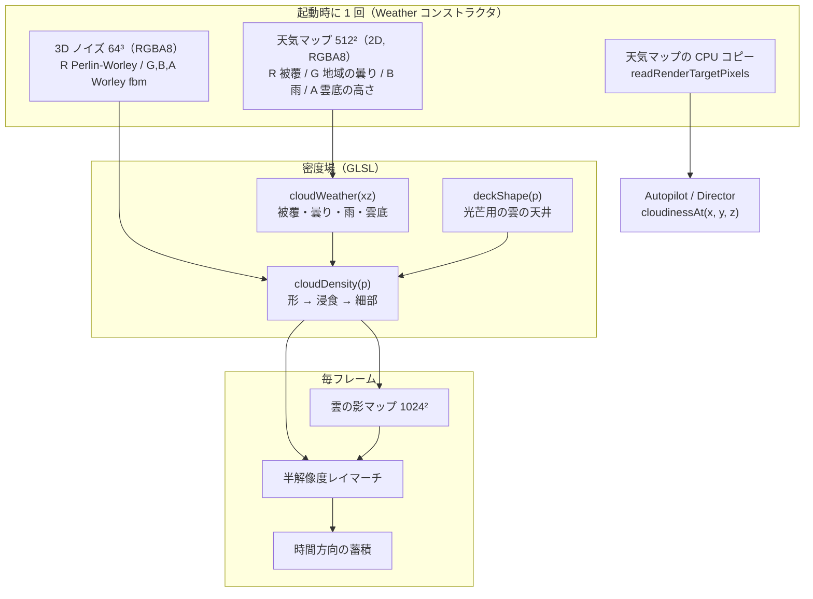
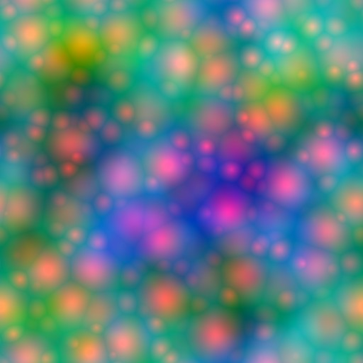
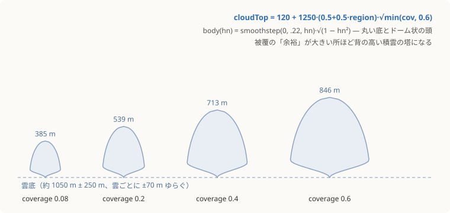
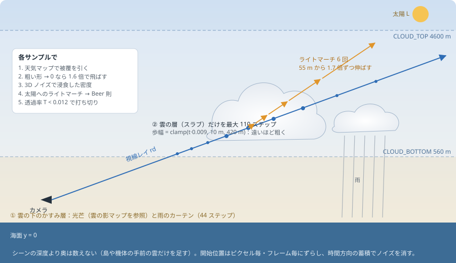
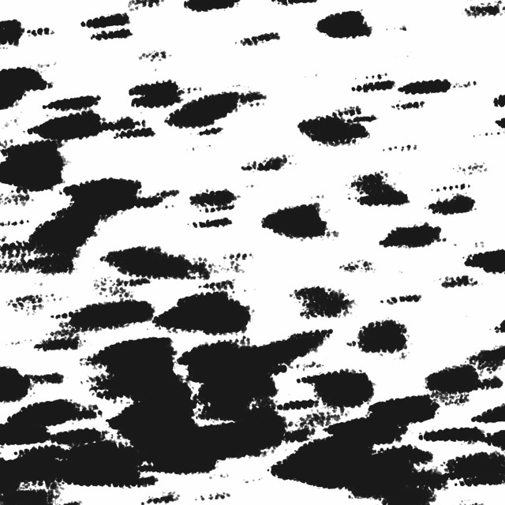

# 5. 雲・光芒・雨

[← 前へ：空・大気・時間と光](04-sky-and-light.md) ｜ [目次](README.md) ｜ [次へ：海 →](06-ocean.md)

関係するファイル：`src/env/weather.ts`、`src/render/shaders/noisegen.ts`、`src/render/shaders/common.ts`（`CLOUD_FIELD_GLSL`）、`src/render/shaders/clouds.ts`

雲はポリゴンではなく **3D の密度場** です。空間の各点に「どれくらい雲が濃いか」を返す関数 `cloudDensity(p)` を定義し、視線に沿ってサンプリングしながら光の散乱と吸収を積分（レイマーチ）します。

| 積雲が浮かぶ朝               | 夜の雲（月明かり）         |
| ---------------------------- | -------------------------- |
|  |  |

## 全体の構成



## 起動時に作るノイズ

### 3D ノイズ（Perlin-Worley）

64³ の 3D テクスチャを、1 スライスずつ `FullscreenPass` で描いて作ります（`renderer.setRenderTarget(noiseRT, z)`）。すべて周期 `period` で `mod` を取った **タイル可能なノイズ** なので、繰り返し貼っても継ぎ目が出ません。

| チャンネル | 中身                                                    | 役割                               |
| ---------- | ------------------------------------------------------- | ---------------------------------- |
| R          | Perlin fbm を Worley fbm で remap した「Perlin-Worley」 | もこもこしつつ、つながった大きな形 |
| G / B / A  | 周波数 8 / 16 / 32 の Worley fbm（反転）                | 細かい浸食。カリフラワー状の凹凸   |

Worley（セルラー）ノイズは「最も近い特徴点までの距離」なので、反転すると丸いこぶが並びます。ただしそのままだとセルの境界に尖った折り目ができるので、密度場の中で `1 − (1 − n)²` と曲げて **丸いこぶ** にしています。

### 天気マップ



_R（赤）＝被覆：大小の丸いセル＝ひとつひとつの雲。G（緑）＝地域の曇り具合。B（青）＝雨の降りやすさ。_

R チャンネルは「いくつかのサイズの Worley セル」を「なめらかなノイズでまとめた」もので、雲が畑や雲列のように集まって並びます。このマップを 2 つのスケール（21 km と 16.5 km 周期）で引き、`sin(uTime·0.006)` でゆっくり混ぜることで、雲の配置が時間とともに発達・消散します。

## 密度場 `cloudDensity`

### 1. 天気を引く（`cloudWeather`）

```glsl
float cloudiness = clamp(region.g * 0.9 + uCloudCover - 0.5, 0.04, 0.9);
// しきい値を超えた「余裕」がそのまま雲の大きさになる
float c = max(cov - (1.0 - cloudiness), 0.0);
```

ここがこの雲表現の要です。被覆マップの値がしきい値をわずかに超えた所は **小さな綿雲**、大きく超えた所は **大きな積雲** になります。`uCloudCover`（全体の雲量）は数分〜十数分周期で揺らいでいるので、空模様がゆっくり変わります。

### 2. 雲の形（高さ方向のプロファイル）

雲底は約 1050 m（地域によって ±250 m）。その上に、被覆の余裕に比例した高さで雲が立ち上がります。



- 底は `smoothstep(0, 0.22, hn)` で丸く、頭は `√(1 − hn²)` でドーム状
- 雲底も完全な水平ではなく、雲ごとに ±70 m、さらに中心ほど少し垂れ下がる（`− min(cov, 0.4)·120`）

### 3. 浸食（billow）

形が決まったら、3D ノイズで外側から削ります。

```glsl
// 1750 m × 1150 m 周期の大きなこぶ（逆 Worley セル 180〜350 m 相当）
vec4 n = textureLod(uNoise3D, q / vec3(1750.0, 1150.0, 1750.0), 0.0);
float billow = rn * 0.5 + gn * 0.5;
float bite = mix(0.45, 0.72, smoothstep(0.05, 0.5, hn));   // 上ほど深く削る
dens = remap(dens, (1.0 - billow) * bite, 1.0, 0.0, 1.0);
```

`remap(v, lo, 1, 0, 1)` は「`lo` 未満を 0 にして残りを引き伸ばす」操作です。ノイズが小さい所ほど `lo` が大きくなり、輪郭が深くえぐれます。上部ほど強く削るので、**頭はカリフラワー状、底は比較的平ら** という積雲らしい形になります。

### 4. 細部（近くだけ）

カメラから 9 km 以内（`detail = t < 9000`）では、さらに 460 m と 110 m 周期のノイズで小さなこぶを足します。110 m のノイズは大きいノイズの値で座標をずらし（ドメインワープ）、こぶが渦を巻いたように見せています。最後に `dens × 2.2` を 0〜1 に制限して、輪郭を少し半透明に広げます（「岩ではなく綿」）。

### 5. 光芒モードの雲の天井（`deckShape`）

`uDeck` が 1 に近づくと、高度 900 m 付近に **切れ間のある層積雲** が現れます。こちらはセル状ではない連続したノイズで「穴の開いたシート」を作り、底面は風向きに伸ばしたうねりと、厚い所で垂れ下がる袋状の起伏で自然な凹凸にしています。

> コメントにもあるとおり、底面の形に **尖ったノイズを使うと 2D マップの折り目がそのまま縦の壁や垂れ下がるトゲ** になってしまうため、ここではなめらかなノイズだけを使っています（コミット `5ecbb5a`「雲の底のつらら状の筋を解消し…」で直した点）。

## レイマーチ（`CLOUD_MARCH_FRAG`）



1 本の視線について 2 段階で積分します。

### ① 雲の下のかすみ層：光芒と雨（44 ステップ）

カメラから最大 26 km（上向きなら高度 1500 m まで）を二次分布のステップで進み、各点で **雲の影マップ** を引きます。

```glsl
float sh = cloudShadowAt(p);                 // その点に太陽光が届くか
float lit = smoothstep(0.35, 0.95, sh); lit *= lit;
shaft += Th * sigH * dts * lit;              // 日の当たる空気だけが光る
```

雲の切れ間から光が届く所だけかすみが光るので、**光の筋（光芒、crepuscular rays）** が現れます。カメラのすぐそば（150 m 以内）は数えないので、画面全体が白くかすむことはありません。


同じループの中で、雨の多い地域の雲の下（1.5 km より遠く）に灰色の **雨のカーテン** も積分します。

### ② 雲の層：最大 110 ステップ

雲の層（高度 560〜4600 m の板＝スラブ）と視線の交点を求め、その区間だけを歩きます。

| 工夫             | 内容                                                                                           |
| ---------------- | ---------------------------------------------------------------------------------------------- |
| 距離に応じた歩幅 | `clamp(t·0.009, 10 m, 420 m)`。近くは細かく、遠くは粗く                                        |
| 空振りの高速化   | まず天気マップだけの粗い密度を見て、0 ならステップを 1.6 倍にして飛ばす                        |
| 早期終了         | 透過率 `T < 0.012` になったら打ち切り（それ以上奥は見えない）                                  |
| シーンの深度     | 島や機体より奥は数えない                                                                       |
| ジッタ           | 開始位置を IGN（Interleaved Gradient Noise）で 0〜1 ステップずらし、フレームごとに黄金比で回す |

### 雲の中の光（ライティング）

各サンプル点から太陽に向かって 6 回、歩幅を 55 m から 1.7 倍ずつ伸ばして密度を足し（ライトマーチ）、光学的厚さ `od` を求めます。そこから次の項を組み合わせます。

```glsl
// 多重散乱の近似：吸収を弱めた Beer 則を 3 つ重ねる（中まで光がにじむ）
float beer = exp(-od) + 0.35 * exp(-od * 0.25) + 0.12 * exp(-od * 0.07);
// パウダー効果：太陽を背にしたとき、こぶの谷間が暗くなる
float powder = clamp((1.0 - exp(-od * 1.8 - 0.1)) * 1.7, 0.0, 1.2);
// 2 つのローブの位相関数：太陽側の銀の縁取り（g = 0.68）+ 柔らかい後方散乱（g = −0.18）
float phase = mix(phaseHG(mu, 0.68), phaseHG(mu, -0.18), 0.38) * 4π;
```

| 項                                     | 見た目への効果                                 |
| -------------------------------------- | ---------------------------------------------- |
| Beer–Lambert（多重散乱近似つき）       | 厚い所ほど暗いが、内部が真っ黒にならない       |
| Henyey–Greenstein 位相関数（2 ローブ） | 逆光の雲の縁が銀色に光る（シルバーライニング） |
| パウダー効果                           | 順光でも凹凸が平板にならない                   |
| 高さで変わる環境光                     | 上は空の青、底は灰色＋海からの照り返し         |
| 雲の天井の底は暗く                     | `uDeck` が強いと、底にあまり空の光が届かない   |

1 ステップ分の散乱は、密度がそのステップ内で一定と仮定した解析解 `(S − S·Ts) / σ` で足しています（エネルギー保存的な積分。歩幅が粗くても明るさが変わりにくい）。

## 雲の影マップ（`CLOUD_SHADOW_FRAG`）



カメラを中心にした 24 km 四方の各テクセルについて、地表から **太陽の方向へ** 雲の層を 30 ステップ歩き、透過率を記録します（完全には 0 にせず最低 0.1。空の光と多重散乱の分）。影の筋が斜めに伸びているのは、低い朝日の方向に雲を透かしているためです。

参照側は、点 `p` を太陽の方向に沿って地表へ投影して引きます。

```glsl
float cloudShadowAt(vec3 p) {
  vec2 g = p.xz - uSunDir.xz * (p.y / max(uSunDir.y, 0.05));
  vec2 uv = (g - uCloudShadowFrame.xy) / uCloudShadowFrame.z + 0.5;
  return texture(uCloudShadow, uv).r;
}
```

このひとつのマップを、海・島・機体・鳥の直射光と、上の光芒の積分が共有しています。マップの中心はテクセル単位にスナップして動かすので、カメラが動いても影がちらつきません。

## CPU からも雲が見える

`Weather` は天気マップを `readRenderTargetPixels` で CPU にコピーしておき、GLSL の `cloudWeather()`・`cloudDensity()`（ノイズ浸食を除いた形まで）・`deckShape()` と **同じ式** を JavaScript で再現しています（`weatherAt` / `cloudinessAt` / `deckAt`）。

これにより、

- 自動操縦が「前方の濃い雲」を見つけて **わざと突っ込む**（[8 章](08-flight-and-camera.md)）
- 雲の中では乱気流を強くし、カメラを機体に寄せる
- カメラが「前方に雲があるから見上げる構図」を選ぶ

といった、絵と挙動が一致した演出ができます。

---

[← 前へ：空・大気・時間と光](04-sky-and-light.md) ｜ [目次](README.md) ｜ [次へ：海 →](06-ocean.md)
