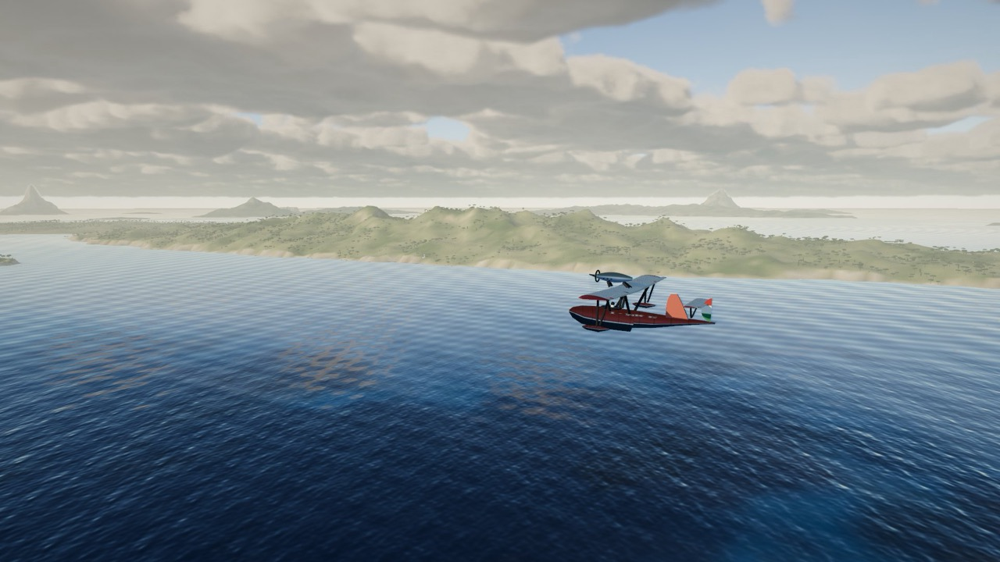
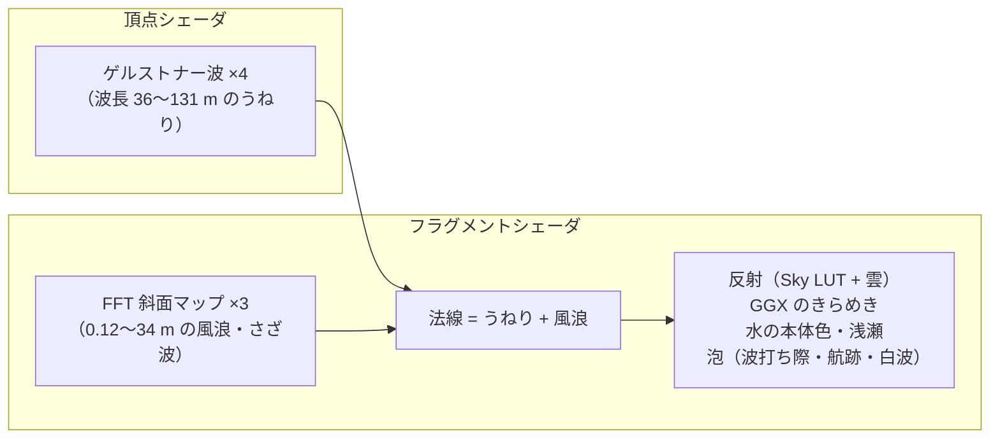
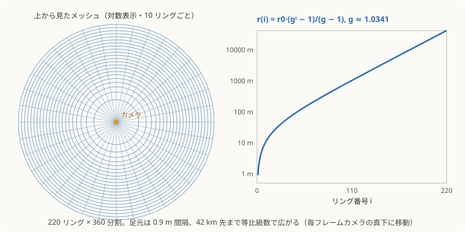
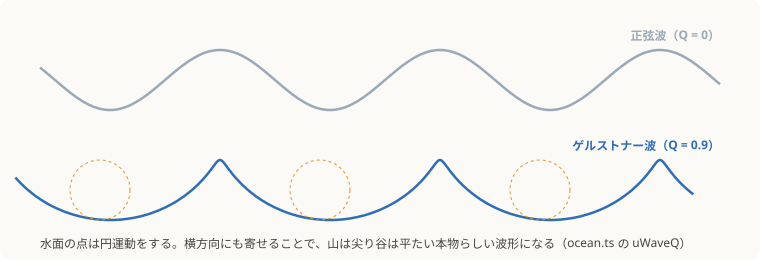
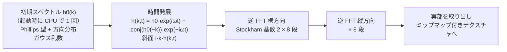
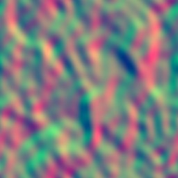
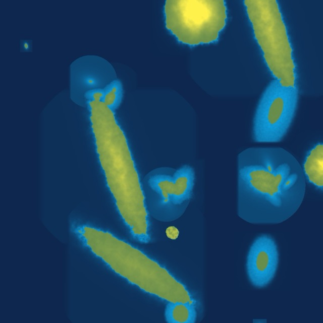
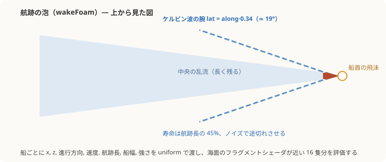

# 6. 海

[← 前へ：雲](05-clouds.md) ｜ [目次](README.md) ｜ [次へ：島の手続き生成 →](07-islands.md)

関係するファイル：`src/world/ocean.ts`、`src/world/oceanFFT.ts`、`src/render/shaders/ocean.ts`

海は「大きなうねり（頂点を動かす）」と「風浪・さざ波（法線だけ）」の 2 層でできています。

| 昼の海（雲の影と反射）    | 月の光の道                 |
| ------------------------- | -------------------------- |
|  |  |



## メッシュ：カメラの足元に密集した放射状グリッド



海は 1 枚の円盤メッシュで、**毎フレームその中心をカメラの真下に移動** します（`uOceanCenter`）。リングの半径は等比級数で増えるので、足元は 0.9 m 間隔、42 km 先の水平線まで約 8 万頂点で覆えます。透視投影では遠くほど 1 ピクセルが広い範囲を覆うので、等比で粗くするとスクリーン上の三角形の大きさがほぼ均一になります。

頂点の位置は「メッシュの座標 + カメラの位置」をワールド座標として波を評価するので、メッシュが動いても波は世界に固定されて見えます。

## うねり：ゲルストナー波



単なる正弦波で上下させると、波は丸く穏やかすぎます。ゲルストナー波では水面の点が **円運動** をするので、頂点を進行方向にも寄せることで、山が尖り谷が平たい本物らしい形になります。

```glsl
float om = sqrt(9.81 * k);                         // 深水波の分散関係 ω = √(g·k)
float ph = k * dot(d, wp.xz) - om * uTime + float(i) * 1.7;
disp.x += Q * A * d.x * cos(ph);                   // 横方向の寄せ（Q が尖り具合）
disp.z += Q * A * d.y * cos(ph);
disp.y += A * sin(ph);
```

| 波長  | 振幅   | 向き      | 尖り |
| ----- | ------ | --------- | ---- |
| 131 m | 0.45 m | 0.35 rad  | 0.28 |
| 83 m  | 0.30 m | 0.95 rad  | 0.26 |
| 52 m  | 0.17 m | −0.30 rad | 0.24 |
| 36 m  | 0.10 m | 1.45 rad  | 0.20 |

工夫：

- 波長の 25〜70 倍より遠くでは振幅を 0 に（遠くの細かい揺れはちらつきの元）
- **浅瀬（水深 14 m 未満）では振幅を 25% まで落とす**。水深は島の高さマップから引く
- 法線は解析的な偏微分（`dx`, `dz` の外積）で求める

## 風浪とさざ波：GPU の FFT 海洋

細かい波は、映画やゲームで定番の Tessendorf の手法（"Simulating Ocean Water"）を GPU で毎フレーム計算しています。

### しくみ



1. **初期スペクトル**（`initialSpectrum`）：風速 8.5 m/s の Phillips スペクトルに方向分布（風下に強く、向かい風側は 1/4）を掛け、各周波数にガウス乱数の振幅を割り当てます。各カスケードの斜面の RMS が目標値になるよう正規化します。
2. **時間発展**（`SPECTRUM_FRAG`）：深水波の分散関係 `ω = √(g|k|)` で位相を回します。高さそのものではなく **斜面 `∂h/∂x`, `∂h/∂z`** のスペクトル（`i·kx·h`, `i·kz·h`）を作ります。2 つとも実数場なので `sx + i·sz` とひとつの複素数に詰め、さらに 2 カスケードを RGBA の xy と zw に詰めて 1 回の FFT で処理します。
3. **逆 FFT**（`BUTTERFLY_FRAG`）：256 点の Stockham 型 FFT を横 8 段・縦 8 段、ピンポンで 16 パス。
4. **Resolve**：実部・虚部をそれぞれ `∂h/∂x`, `∂h/∂z` として、**ミップマップと異方性フィルタ付き** のテクスチャへ書き出します。



### 3 段のカスケード

| カスケード | タイルの大きさ | 受け持つ波長 | 斜面の RMS |
| ---------- | -------------- | ------------ | ---------- |
| 0          | 71.3 m         | 5.2〜34 m    | 0.075      |
| 1          | 13.7 m         | 0.95〜5.2 m  | 0.07       |
| 2          | 3.31 m         | 0.12〜0.95 m | 0.05       |

タイルの大きさは互いに割り切れない値で、さらにシェーダ側でカスケードごとに異なる角度（0, 0.61, −0.83 rad）に回転・ずらして重ねるので、**繰り返し模様が見えません**。

## 海面のシェーディング

### ちらつき対策（スペキュラー・アンチエイリアシング）

遠くでは 1 ピクセルに何十もの小さな波が入り、そのまま評価するとギラギラしたノイズになります。この実装では 3 段構えで対策しています（コミット `c13d8e4`「海のガビガビを解消」）。

1. **カスケードのフェード**：1 ピクセルが覆う距離 `fwidth(P.xz)` を見て、そのカスケードの最小波長が解像できなくなったら寄与を消す。
2. **ミップマップ**：斜面マップを平均化して引く（細かい波は自然に平らになる）。
3. **法線の分散を粗さに足す**：`dFdx(N)`, `dFdy(N)` からピクセル内の法線のばらつきを求め、GGX の粗さに足す（Toksvig 系の手法）。反射ベクトルもなめらかなうねりの法線に寄せる。

```glsl
float nVar = dot(dNx, dNx) + dot(dNy, dNy);
float rough = mix(0.06, 0.22, smoothstep(80.0, 9000.0, dist)) * mix(0.85, 1.15, gust);
rough = sqrt(rough * rough + min(nVar * 1.5, 0.12));
```

距離とともに粗さが増えるので、遠くの太陽や月の反射は **細長い光の道** になります。

### 光の成分

| 成分                 | 内容                                                                                                                       |
| -------------------- | -------------------------------------------------------------------------------------------------------------------------- |
| フレネル反射         | Schlick 近似 `0.02 + 0.98·(1 − N·V)⁵`（上限 0.85）。真下は透けて、水平線は鏡                                               |
| 空の映り込み         | 反射ベクトルで Sky LUT を引く                                                                                              |
| 雲の映り込み         | 反射ベクトルが高度 1300 m に届く点で天気マップを **ミップ付きで** 引く（雲は大きいので、さざ波ではなくうねりの法線で反射） |
| 太陽・月のきらめき   | GGX 分布のスペキュラー × 雲の影。1 ピクセルの蛍を防ぐため 40 で頭打ち                                                      |
| 水の本体             | 深い紺〜日が差し込む所は少し明るい青緑。逆光の波の斜面には SSS 風の緑                                                      |
| 突風（キャッツポー） | 風下へ流れる fbm のパッチで、さざ波の強さと粗さを変える。海面に濃淡のまだらが動く                                          |

### 浅瀬

水深 60 m 未満では、海底を水越しに見た色を混ぜます。

```glsl
vec3 absorb = vec3(0.38, 0.068, 0.03);   // 赤から先に吸収される
vec3 tr = exp(-absorb * depth * 1.1);
```

- 砂地の色に、fbm で **暗い海草の群落** を散らす
- 水深 7 m 未満・近距離では、2 つのノイズの差から作った **コースティクス**（光の網目）が揺れる
- 水深 4 m 未満では、波打ち際の泡が沖から寄せる帯になって動く

水深は、島マネージャーが真上から描いた **高さマップ** から引きます（[7 章](07-islands.md)）。



### 航跡（ケルビン波）と白波



船ごとの位置・向き・速度・航跡長・船幅・強さを uniform 配列で渡し、海面のピクセルごとに近い 16 隻分を評価します（どの 16 隻かは CPU 側でカメラに近い順に選ぶ）。

- 中央の乱流：船の後方にガウス分布の帯、後ろほど広がり薄くなる
- ケルビン波の腕：中心線から約 19°（`lat = along·0.34`）の V 字。寿命は航跡の 45% で、ノイズで途切れさせる
- 船首の飛沫

白波は、突風の強い所・うねりの山の上・ノイズの高い所が重なった場所にだけ、遠くでは消えるように出します。

---

[← 前へ：雲](05-clouds.md) ｜ [目次](README.md) ｜ [次へ：島の手続き生成 →](07-islands.md)
