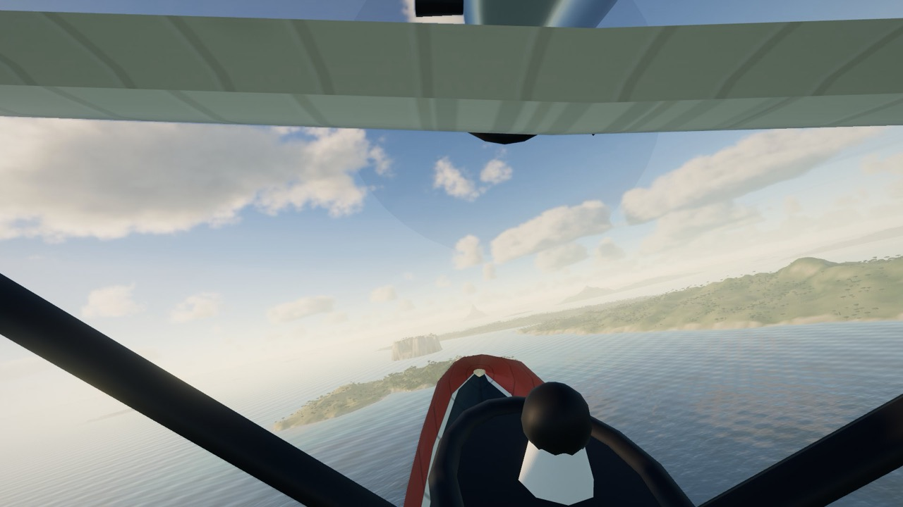
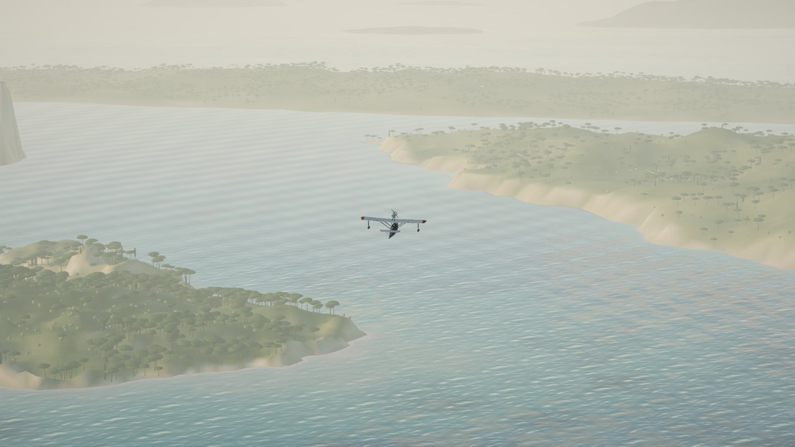
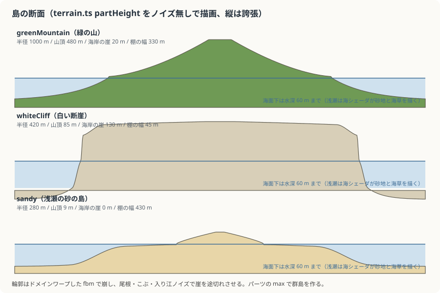
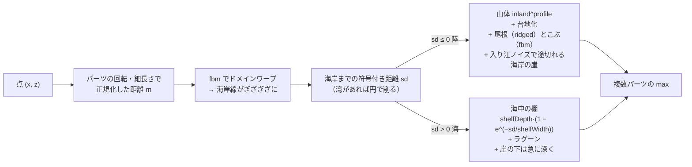
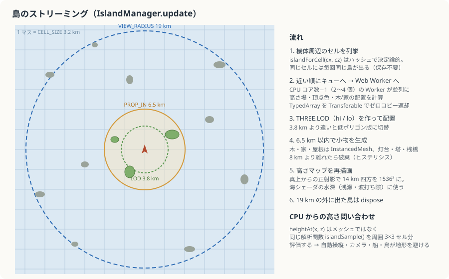
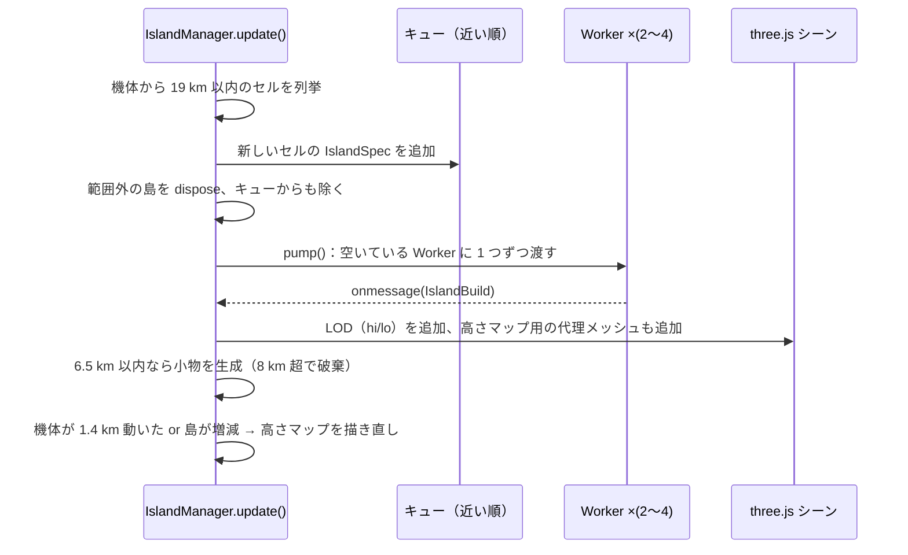
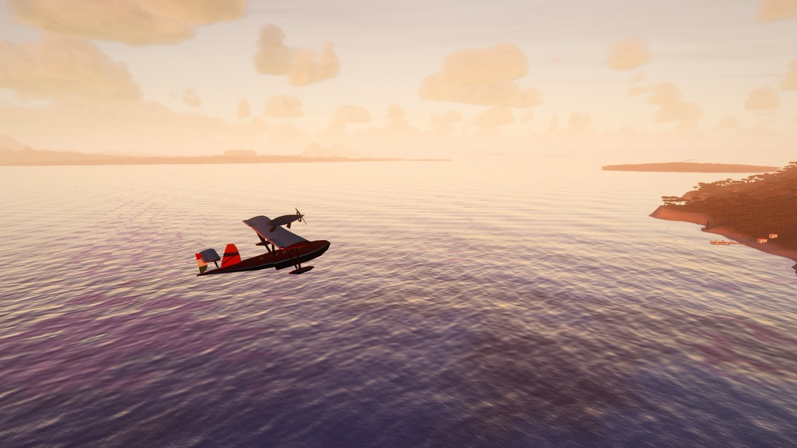
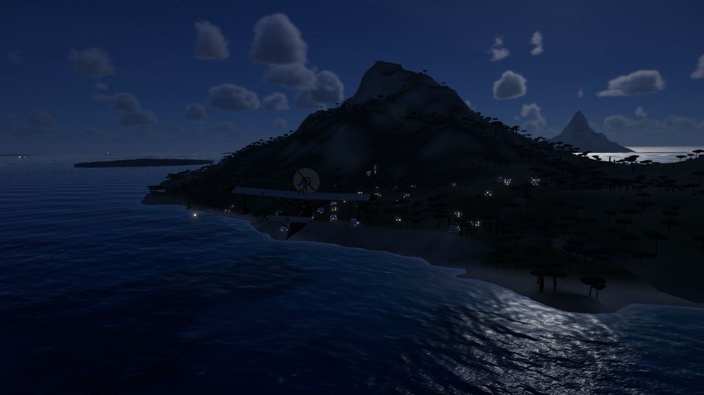

# 7. 島の手続き生成

[← 前へ：海](06-ocean.md) ｜ [目次](README.md) ｜ [次へ：自動操縦とカメラ →](08-flight-and-camera.md)

関係するファイル：`src/world/islands/terrain.ts`、`builder.ts`、`worker.ts`、`manager.ts`、`src/world/props.ts`

| 緑の山の島（コックピットから） | 島々の並ぶ海              |
| ------------------------------ | ------------------------- |
|    |  |

## 無限の海に島を置く：セルと決定論

世界を 3.2 km 四方のセルに区切り、**各セルに島が 0 か 1 個** あります。島があるか・どんな島かはセル座標のハッシュだけで決まるので、何度同じ場所に来ても同じ島があり、データを保存する必要がありません。

```ts
export function islandForCell(cx: number, cz: number): IslandSpec | null {
  const h = hash2i(cx, cz, 7);
  // 地域ごとの密度：島の少ない外海と、島の多い群島がある
  const region = perlin2(cx * 0.23 + 3.1, cz * 0.23 - 1.7, 99) * 0.5 + 0.5;
  const density = 0.38 + region * 0.5;
  if (cx === 0 && cz === 0) return null;        // 開始地点は空けておく
  if (h > density) return null;
  const r = rng(Math.floor(hash2i(cx, cz, 11) * 2 ** 31));   // このセル専用の乱数列
  const type = pickType(r());
  // セル内で位置をずらし、格子状に並んで見えないようにする
  ...
}
```

`IslandSpec` は「パーツ（楕円の山）の集まり」です。各パーツが半径・細長さ・回転・山頂の高さ・断面の形・海岸の崖・海中の棚・植生の濃さなどを持ちます。

## 10 種類の島

| 種類                     | 形                                           | 付属物                 |
| ------------------------ | -------------------------------------------- | ---------------------- |
| `reef` 岩礁              | 1〜4 個の低い岩。植生なし                    | ―                      |
| `whiteCliff` 白い断崖    | 台地状（plateau 0.8）、海岸に 60〜140 m の崖 | 30% で灯台             |
| `greenMountain` 緑の山   | 半径 0.7〜1.35 km、標高 330〜660 m           | 55% で村、25% で古い塔 |
| `longIsland` 細長い島    | 細長さ 3〜5.2 倍                             | 35% で灯台             |
| `archipelago` 群島       | 4〜8 個の小島。半分はラグーン                | 30% で灯台             |
| `villageCove` 入り江の村 | 山の一部を円で削って **湾** を作る           | 必ず村、40% で灯台     |
| `lighthouse` 灯台の小島  | 半径 55〜135 m の岩                          | 必ず灯台               |
| `tower` 古い塔の島       | 中くらいの丘                                 | 必ず廃墟の塔           |
| `pine` 松の島            | 低くなだらか、松が多い                       | ―                      |
| `sandy` 浅瀬の砂の島     | 標高 4〜14 m、広いラグーン（浅い棚）         | ―                      |



## 高さ関数 `partHeight`

島の高さは **解析的な関数** です。メッシュを作るときも、自動操縦が地形を避けるときも、同じ関数を呼びます（だから `terrain.ts` はメインスレッドと Worker の両方から import されます）。



ポイントは **海岸までの符号付き距離 `sd`** を中心に組み立てていることです。陸側では `sd` から「内陸度」を作って山の形に、海側では `sd` から水深を作るので、どんな形の島でも海岸線で陸と海がなめらかにつながります。海中の棚の形がそのまま海シェーダの「浅瀬の色」になります。

## メッシュ化（Web Worker）

`builder.ts` の `buildIsland(spec)` は、島を囲む正方形を格子に分けて高さ関数を評価し、2 段階の LOD を作ります。

|      | 格子数                         | 用途            |
| ---- | ------------------------------ | --------------- |
| `hi` | 48〜300（約 2.5 m 間隔を目安） | 3.8 km 以内     |
| `lo` | `hi` の 1/4                    | 3.8 km より遠く |

細かい工夫：

- **タイルの縁は水深 60 m へフェード**：島のメッシュの端が浅瀬に見えて継ぎ目が出ないように
- **対角線の向きを地形に合わせる**：四角形を 2 つの三角形に分けるとき、高低差の小さい対角線を選ぶ（尾根や崖の稜線がギザギザにならない）
- **頂点色で塗る**（テクスチャなし）

### 頂点色の塗り分け

地中海の植生の移り変わりを、ノイズで作った「緑の濃さ」に沿って混ぜています。

```
金色の枯れ草 → 灰緑のガリーグ（低い灌木）→ 濃いマキ（常緑の茂み）→ 松林
```

- 急斜面・崖・植生の薄い所・ノイズで選んだ露頭は **石灰岩（白〜黄土）**、植生のない岩礁は暗い岩
- 崖には高さで変わる薄い **地層の縞**
- 海抜 1.2〜5 m は **砂浜**、0.9 m 未満は濡れた砂、海中は海底の砂色
- ラプラシアン（周囲より低いか）で **くぼみを暗く**（簡易 AO）
- 高い所ほど乾いて岩がちに

### 小物の配置データ

同じ Worker で、木・家・灯りなどの **配置だけ** を Float32Array で計算します。

| データ                 | 中身                                                | 決め方                                                                             |
| ---------------------- | --------------------------------------------------- | ---------------------------------------------------------------------------------- |
| `trees`                | x, y, z, 大きさ, 回転, 種類（傘松・糸杉・オリーブ） | 植生の濃い所に、クラスタ（森と空き地）を作って。最大 22,000 本                     |
| `houses`               | x, y, z, 回転, 幅, 奥行, 高さ, 屋根（平/瓦/鐘楼）   | 村は「いちばんなだらかな海岸」から内陸へ、港を囲むように斜面に張り付く。互いに離す |
| `lights`               | x, y, z, 種類（窓/港の灯）                          | 家の窓、桟橋の灯                                                                   |
| `lighthouse` / `tower` | 位置                                                | 岬（海岸に近い高い所）                                                             |
| `pier` / `moorings`    | 桟橋、舫われた小舟                                  | いちばん低い家から海へ                                                             |
| `cliffs`               | カモメの営巣地                                      | 崖の上                                                                             |

結果の TypedArray は `postMessage(b, transfer)` の **Transferable** で返すので、コピーなしでメインスレッドに渡ります。

## ストリーミングと LOD（`IslandManager`）





- Worker の数は `navigator.hardwareConcurrency − 1`（2〜4 個）
- `islands.loading`（キュー + 処理中）がローディング画面の進捗に使われます
- 小物は **InstancedMesh**：木は 3 種、家は壁と屋根の 2 つで、島ごとに数百〜数千のインスタンスを 1 ドローコールで描きます
- 灯台の光（夜だけ回転する半透明の円錐、加算合成）、ランタンの発光、舫われた小舟の揺れは `onBeforeRender` やフレーム更新で動かします

| 夕方の海岸（右に松林と村の家） | 夜の同じ島（窓の灯りと港の灯） |
| ------------------------------ | ------------------------------ |
|    |   |

## 高さマップ：海から島が見えるように

海のシェーダは、浅瀬の色・波の減衰・波打ち際の泡のために **水深** を知る必要があります。そこで島マネージャーは、

1. 島の hi メッシュを共有した「代理メッシュ」と、深さ 60 m の海底の板を別シーンに置く
2. 真上から正射影カメラで、14 km 四方を 1536² のテクスチャに描く（色の代わりに **ワールドの y 座標** を書き出すシェーダ）
3. `G.uHeightMap` / `G.uHeightFrame` として全シェーダに公開

機体が 1.4 km 動くか、島が増減したときだけ描き直します。

## CPU からの地形の問い合わせ

```ts
heightAt(x: number, z: number): number {
  // 周囲 3×3 セルの島について、解析関数 islandSample() の max を取る
}
near(x: number, z: number, radius: number): Island[]   // 近い順
```

メッシュを読むのではなく高さ関数を直接評価するので、まだメッシュが届いていない島でも正しい高さが返ります。自動操縦・カメラの地面めり込み防止・船の航路・鳥の営巣地探しが、すべてこれを使います。

---

[← 前へ：海](06-ocean.md) ｜ [目次](README.md) ｜ [次へ：自動操縦とカメラ →](08-flight-and-camera.md)
