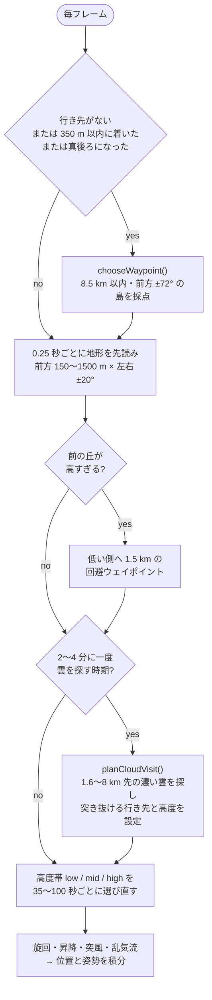
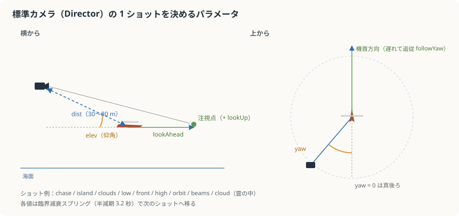
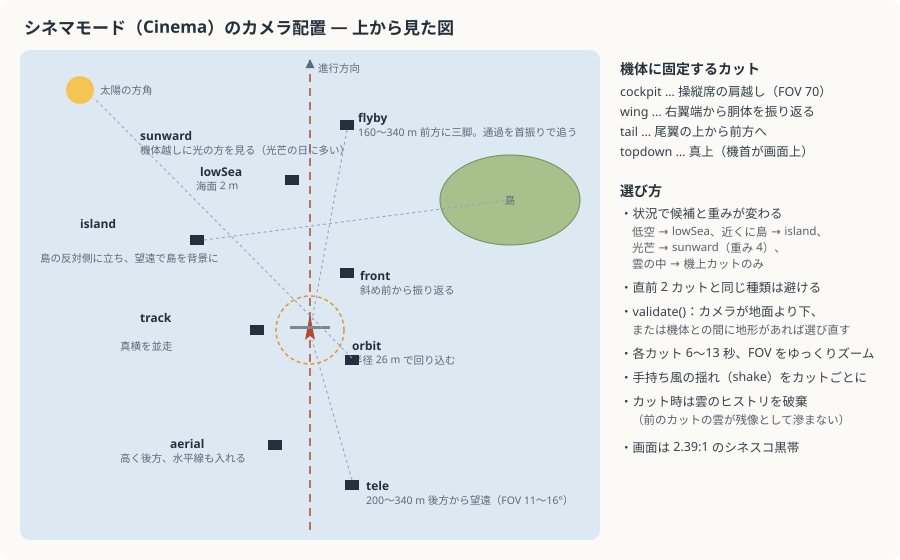
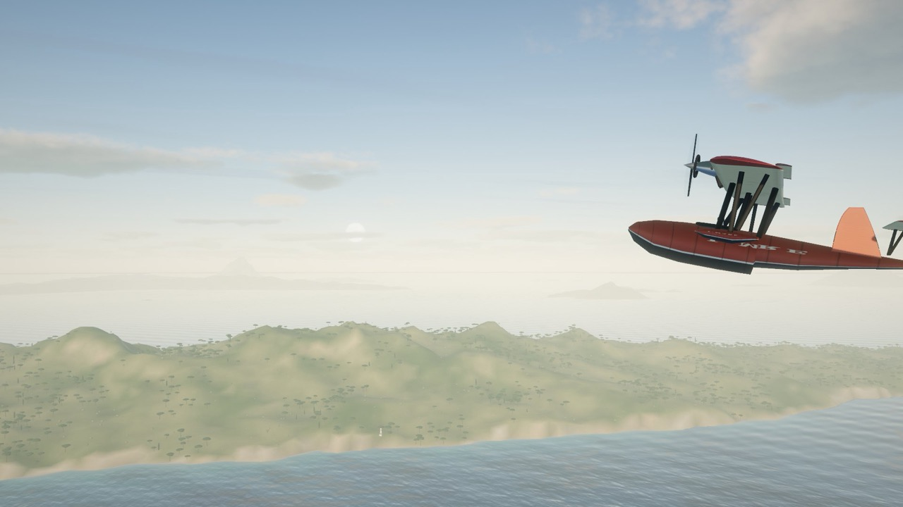
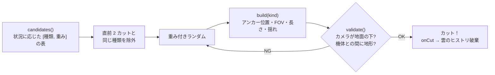

# 8. 自動操縦とカメラ

[← 前へ：島の手続き生成](07-islands.md) ｜ [目次](README.md) ｜ [次へ：生きている世界 →](09-world-life.md)

関係するファイル：`src/flight/autopilot.ts`、`src/flight/director.ts`、`src/flight/cinema.ts`、`src/core/math.ts`

この作品の「アニメーション」の大部分は、キーフレームではなく **目標を決めて、なめらかに寄せる** ことで生まれています。自動操縦は「どこへ・どの高さへ」を、カメラは「どんな構図へ」を決め、あとは減衰とバネが動きを作ります。

## 自動操縦（`Autopilot`）

「落ち着いた、好奇心のあるパイロット」がコンセプトです。急がず、興味のある島を見に行き、ときどき雲に入ります。

### 判断の流れ



### 島の選び方（採点）

```ts
let score =
  interest[s.type] * 2 - // 種類ごとの面白さ（村 1.3、群島 1.25、岩礁 0.6 …）
  off * 1.4 - // 機首からの角度のずれ（曲がらずに済む方がよい）
  Math.abs(d - 3500) / 3000 + // 3.5 km くらい先が理想
  Math.random() * 0.8; // 気まぐれ
if (this.visited.includes(s.id)) score -= 3; // 最近の 12 島は避ける
```

行き先は島の中心ではなく、**島の横を海岸沿いにかすめる点**（島の大きさ × 0.75 + 220〜600 m 横）です。曲がる量が少ない側を選びます。群島・砂の島・岩礁は 45% の確率で真上を通過します。

### 高度帯

| 帯   | 高度                                                        | 選ばれる確率 | 持続       |
| ---- | ----------------------------------------------------------- | ------------ | ---------- |
| low  | 45〜115 m（海面すれすれ）                                   | 34%          | 45〜100 秒 |
| mid  | 170〜470 m                                                  | 38%          | 45〜100 秒 |
| high | 640〜1160 m（雲底付近）<br/>雲の天井があるときは 380〜640 m | 28%          | 35〜70 秒  |

直前と同じ帯が出たときは半分の確率で別の帯に変えます。さらに `wobble` で高度をゆらし、地形の先読み結果より必ず 45〜80 m 上を飛びます。最後の安全策として、地面 + 18 m より下には絶対に行きません。

### 雲の中を飛ぶ

`planCloudVisit()` は前方の扇形（距離 1.6〜8 km、角度 ±0.6 rad）を格子状に調べ、`Weather.cloudinessAt()` が 0.45 以上で、下に山がなく、**ゆるやかな上昇率で間に合う** 雲を探します。見つかったら、その雲を通り抜けて 1.8 km 先へ抜ける行き先と、雲の高さを設定します。見つからなければ次に備えて高度を上げます。

### 機体の運動

物理シミュレーションではなく、「それらしく見える」運動学です。

```ts
// 協調旋回：旋回率と速度から、横滑りしないバンク角を求める
const bankTarget = Math.atan((this.speed * this.turnRate) / 9.81);
this.roll = damp(this.roll, bankTarget + gRoll + tRoll, 1.6, dt);
// 機首の上下は上昇率から
this.pitch = damp(this.pitch, Math.atan2(this.verticalSpeed, this.speed) + ..., 1.4, dt);
// 上りでは減速、下りでは増速
this.speed = damp(this.speed, 50 + wobble(...) * 4 - this.verticalSpeed * 0.8, 0.3, dt);
```

| 要素   | 内容                                                                                  |
| ------ | ------------------------------------------------------------------------------------- |
| 旋回   | 最大 0.075 rad/s。誤差 × 0.18 を目標旋回率にし、`damp` でなめらかに                   |
| 蛇行   | まっすぐな区間でも `wobble` で ±0.25 rad ゆるく揺れる（ロボットっぽさを消す）         |
| 突風   | 15〜50 秒に一度、2.5〜5 秒かけて `sin²` の形でロールとピッチが入る                    |
| 乱気流 | 風速・雲の濃さ・低空（120 m 未満）で強くなる。ロール・ピッチ・上下動に `wobble`       |
| 横風   | 風の 15% で機体が流される                                                             |
| 舵面   | `main.ts` で旋回率から方向舵と補助翼、上昇率から昇降舵を動かす。プロペラは毎秒 55 rad |

## 標準カメラ（`Director`, モード「標準」）



ひとつのショットは `yaw`（機体の後ろから何度回り込むか）、`elev`（仰角）、`dist`（距離）、`fov`、`lookAhead`（注視点を機首方向にどれだけ先へ）、`lookUp`（注視点の高さ）、`orbit`（ゆっくり回る速さ）、`faceSun`、`duration` で表されます。

### 状況から構図を選ぶ（`pickShot`）

| 状況                               | 選ばれやすいショット                     | 狙い                                             |
| ---------------------------------- | ---------------------------------------- | ------------------------------------------------ |
| 光芒の雲の天井があり太陽が出ている | `beams`（80%）                           | 太陽の反対側から、機体越しに光の筋を見る         |
| 2.2 km 以内の前方に島              | `island`（60%）                          | 島と反対側から、機体越しに島を見る               |
| 前方上空に雲                       | `clouds`                                 | 低めから見上げ、注視点を 38 m 上に               |
| 高度 150 m 未満                    | `low`                                    | 海面すれすれ、少し見下ろす                       |
| それ以外                           | `chase`（50%）, `front`, `high`, `orbit` | 追従、前方から振り返り、高い俯瞰、ゆっくり周回   |
| 雲の中                             | `cloud`                                  | 距離 22 m まで寄って、霧の中でも機体を見失わない |

### 気づかないほど滑らかな遷移

各パラメータは **臨界減衰バネ**（半減期 3.2 秒）で次のショットの値へ移ります。

```ts
const hl = 3.2;
const yaw = this.yaw.update(s.yaw + this.orbitAcc, hl, dt);
const dist = this.dist.update(s.dist, hl, dt) * this.userZoom;
```

`damp`（指数減衰）だと切り替えの瞬間に速度が不連続になり「カクッ」と動き出しますが、バネは速度を保持するので、**加速もなめらか** です。さらに、

- 機体の向きには 1 秒程度遅れて追従（`followYaw`）→ 旋回で画面がふわっと振られる
- `wobble` で距離がわずかに呼吸する
- 機体のバンクの 18% だけカメラも傾く
- 地面・海面より 4 m 下には入らない

ユーザーがドラッグやホイールで動かした分（`userYaw` など）は、4 秒操作がないとゆっくり 0 に戻ります。

## シネマモード（`Cinema`, モード「シネマ」）

標準カメラが「ひとつの長回し」なのに対し、シネマモードは **カットを切る** オートディレクションです。画面には 2.39:1 のシネスコの黒帯が出ます。



| track（並走）              | wing（翼端）                 |
| -------------------------- | ---------------------------- |
|  |     |
| **tele（望遠）**           | **cockpit（操縦席）**        |
|   |  |

### カット選び



ショットの種類は 3 系統あります。

- **三脚（ワールド固定）**：`flyby`, `lowSea`, `island`。機体の未来位置の近くにカメラを置き、通り過ぎる機体を「流体ヘッドの雲台」のように少し遅れて首振りで追う（`damp(aim, p, 7, dt)`）。
- **機体に対する相対位置**：`tele`, `track`, `front`, `aerial`, `topdown`, `orbit`, `sunward`。機体の向き（2.2 の減衰で追従）を基準に配置。
- **機体に固定**：`cockpit`, `wing`, `tail`。機体ローカル座標に置き、カメラの上方向も機体の傾きに合わせる。

各カットは 6〜13 秒。カットの間に FOV を `smoothstep` でゆっくりズームし、`shake` の量だけ手持ちカメラ風の揺れを入れます（コックピットではエンジンの細かい振動も）。

## フォトモード

`P` キーまたはカメラアイコンで入ります。

- 世界の時間を止め（`dt = 0`）、適応解像度を一時的に 1.0 に戻して最高画質に
- ドラッグで機体の周りを回り込み、ホイールで 7〜600 m、スライダーで FOV 10〜100°
- 時間帯ボタンは使えるので、**止めた世界で光だけ変えられる**
- `撮影`（Space）で、描画直後のキャンバスを `toBlob` で PNG 保存（ファイル名に撮影日時とゲーム内時刻）
- 終了時は `timer.reset()` で、止まっていた時間の分だけ世界が飛ばないようにする

---

[← 前へ：島の手続き生成](07-islands.md) ｜ [目次](README.md) ｜ [次へ：生きている世界 →](09-world-life.md)
