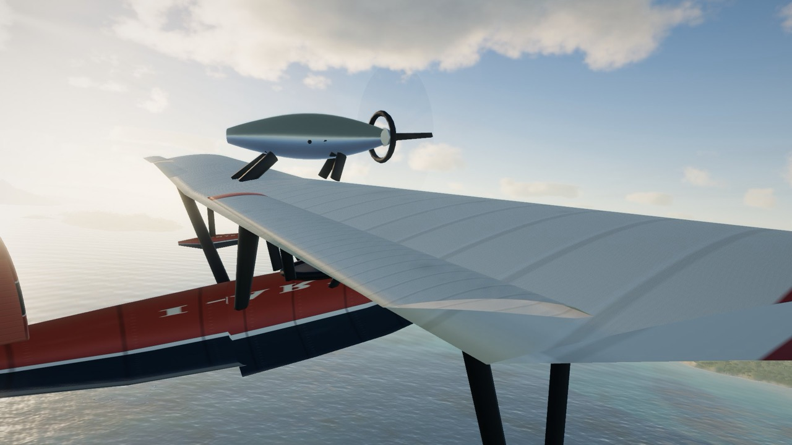
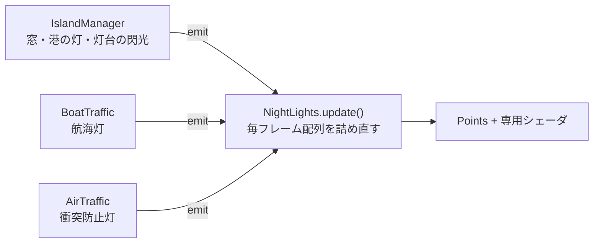

# 9. 生きている世界

[← 前へ：自動操縦とカメラ](08-flight-and-camera.md) ｜ [目次](README.md) ｜ [次へ：UI・ローディング・性能 →](10-ui-and-performance.md)

関係するファイル：`src/world/plane.ts`、`boats.ts`、`boatModels.ts`、`birds.ts`、`traffic.ts`、`nightLights.ts`、`props.ts`、`src/render/worldMaterial.ts`

## 飛行艇のモデル（`buildPlane`）

1930 年代の小さな飛行艇を、`BufferGeometry` を直接組み立てて作っています。



| 部品               | 作り方                                                                                                                                                                              |
| ------------------ | ----------------------------------------------------------------------------------------------------------------------------------------------------------------------------------- |
| 船体               | **ロフト**：機首から尾部まで断面（幅・甲板の高さ・キール・チャイン）を並べ、各断面をリング状にして側面をつなぐ。上半分は超楕円の丸い甲板、下半分はチャインからキールへの V 字の船底 |
| 主翼（パラソル翼） | 対称翼型の断面をスパン方向に並べ、翼端を丸める。上反角・後退角のオプション                                                                                                          |
| エンジン           | 翼の上に支柱で載せたナセルとプロペラ。回転中は半透明の円盤（`propDisc`）でブレを表現                                                                                                |
| 尾翼               | 垂直尾翼・水平尾翼と、動く方向舵・昇降舵・補助翼（`rudder`, `elevator`, `aileronL/R`）                                                                                              |
| 支柱・フロート     | 円柱を 2 点間に張る `strut()`                                                                                                                                                       |

模様はすべて `<canvas>` に描いたテクスチャです。

- 主翼：羽布のリブの筋、前縁の汚れ、後縁のすす、赤い翼端、エンジン後ろのオイルの筋
- 船体：赤い塗装、喫水線下の濃色、パネルラインとリベット、機体記号
- `speckle()` でランダムな細かい汚れを散らし、「使い込まれた」質感に

マテリアルは `MeshStandardMaterial` を `patchWorldMaterial` で拡張したもの（後述）なので、雲の影が機体にも落ちます。機体だけは three.js の `DirectionalLight` の影（2048² PCF）も受け、翼の影が船体に落ちます。

## 船の往来（`BoatTraffic`）

常に 11 隻前後の船が、機体の周りの海を行き交います。

| 種類             | 割合 | 速さ         |
| ---------------- | ---- | ------------ |
| ヨット `sail`    | 40%  | 3〜5.5 m/s   |
| 漁船 `fishing`   | 28%  | 2.5〜4.5 m/s |
| フェリー `ferry` | 17%  | 8〜11 m/s    |
| 貨物船 `cargo`   | 15%  | 6〜8 m/s     |

- **出現**：65% は機体の前方（±46°）に置き、出会いが起きやすくする。15 km より離れたら消える
- **陸を避ける**：1.5 秒ごとに前方と左右 ±40° を `islands.heightAt()` で調べ、陸なら開いている側へ舵を切る。大型船ほどゆっくり曲がる
- **波に揺れる**：大きさに応じた周期で上下・ローリング
- **ヨットは風を受ける**：風と進行方向の角度から、帆の向きと船体の傾き（ヒール）を計算。`G.uWind` を共有しているので、雲や波と同じ風で帆が張る
- **航跡**：位置・向き・速度などを `WakeSource` として海のシェーダに渡す（[6 章](06-ocean.md)）
- **夜**：モデルが持つ航海灯の位置（赤・緑・白）を夜の灯りに登録

## カモメ（`Birds`）

最大 420 羽を **1 つの `InstancedMesh`** で描きます。

### 羽ばたきは頂点シェーダで

鳥のジオメトリは三角形 17 枚だけで、頂点ごとに `aSeg`（0 = 胴体、1 = 内側の翼、2 = 外側の翼）を持ちます。インスタンスごとの `aAnim`（羽ばたきの位相・振幅・滑空時の上反角）から、頂点シェーダで翼を関節ごとに回します。

```glsl
float a1 = sin(aAnim.x) * aAnim.y + aAnim.z;          // 肩の角度
float a2 = sin(aAnim.x - 0.9) * aAnim.y * 0.7 - ...;   // 肘の角度（少し遅れる → しなる）
if (aSeg > 0.5) {
  float s1 = min(span, 0.36);                // 肩から肘まで
  p.y += s1 * sin(a1);  ...
  if (aSeg > 1.5) { /* 肘から先はさらに a2 を足して回す */ }
}
```

CPU は 1 羽あたり行列 1 つと `aAnim` の 3 つの数を更新するだけです。

### 4 つの振る舞い

| モード   | 内容                                                                                                                        |
| -------- | --------------------------------------------------------------------------------------------------------------------------- |
| `colony` | 近くの島の崖（営巣地）の上を 4〜11 羽が旋回                                                                                 |
| `cross`  | 12〜30 秒に一度、**機体の前方を群れが横切る**。到達時刻を計算して、ちょうど機体の前を通るように配置。20% で 24〜40 羽の大群 |
| `skim`   | 低空飛行中は、群れが海面すれすれを横切り、やがて上昇気流に乗って上がる                                                      |
| `glide`  | 20〜50 秒に一度、1〜2 羽が遠くを羽ばたかずに滑空                                                                            |

各鳥は群れの中の目標位置に向かって、速度上限つきで舵を切ります。羽ばたきは「数回はばたいて滑空」を繰り返し、上昇中ははばたきが増えます。旋回の向きに合わせてバンクします。

## 遠くを飛ぶ別の飛行機（`AirTraffic`）

数分に一度、同じ飛行艇のモデルが前方 1.6〜3.8 km を横切るように現れ、110 秒ほどで去ります。夜は赤い衝突防止灯が点滅します。「ほかにも旅をしている人がいる」という気配の演出です。

## 夜の灯り（`NightLights`）


窓・港の灯・灯台・船の航海灯・飛行機の灯を、**1 つの `THREE.Points`（最大 4096 点）** にまとめて描きます。



- 各モジュールは `lights.addProvider(emit => ...)` で「灯りを出す関数」を登録するだけ。毎フレーム全プロバイダを呼んで位置・色・強さ・大きさを配列に詰め直します（4096 点なので安い）
- 頂点シェーダで、ワールドでの大きさ（m）から画面上のピクセルサイズを計算。**遠くても最低 2.2 px** にして消えないようにし、その代わり少し暗くする
- 窓の灯は `sin` の積でかすかにちらつく。灯台は回転に合わせて強く閃く
- フラグメントはガウス状の丸い点。HDR で明るいのでブルームでにじむ

島の家の壁そのものにも窓があります（次節）。

## 共通のマテリアル拡張（`patchWorldMaterial`）

島・木・家・機体には three.js 標準の `MeshStandardMaterial` を使っていますが、そのままでは雲の影や風を知りません。そこで `onBeforeCompile` で **標準シェーダのコードに文字列置換で処理を注入** しています。

| オプション    | 注入する処理                                                                 | 差し込む場所                               |
| ------------- | ---------------------------------------------------------------------------- | ------------------------------------------ |
| （常に）      | ワールド座標と法線を varying で渡す                                          | `#include <project_vertex>` の後           |
| `cloudShadow` | 太陽光に雲の影マップを掛ける                                                 | `getDirectionalLightInfo(...)` の直後      |
| `sway`        | 高さの二乗に比例して風下へ曲げる（木の揺れ）。インスタンスごとに位相をずらす | `#include <begin_vertex>` の後             |
| `breakup`     | ワールド座標のノイズで色をわずかにまだらに（大きな面ののっぺり防止）         | `#include <color_fragment>` の後           |
| `windows`     | 壁の向きに応じた格子で窓を描き、夜はハッシュで選んだ窓だけ橙色に発光         | `color_fragment` と `emissivemap_fragment` |

```ts
// 雲の影：three.js のライティング計算の途中に 1 行足すだけ
shader.fragmentShader = shader.fragmentShader.replace(
  "getDirectionalLightInfo( directionalLight, directLight );",
  "getDirectionalLightInfo( directionalLight, directLight );\n\t\tdirectLight.color *= cloudShadowAtW(vCSWorld);",
);
// オプションの組み合わせごとに別のシェーダプログラムとしてキャッシュさせる
mat.customProgramCacheKey = () =>
  `world-${sway}-${breakup}-${opts.windows ? 1 : 0}-${shadow ? 1 : 0}`;
```

標準マテリアルの PBR・影・環境光（PMREM）の恩恵を受けながら、世界共通の雲の影・風・夜の振る舞いを足せるのがこの方式の利点です。

---

[← 前へ：自動操縦とカメラ](08-flight-and-camera.md) ｜ [目次](README.md) ｜ [次へ：UI・ローディング・性能 →](10-ui-and-performance.md)
