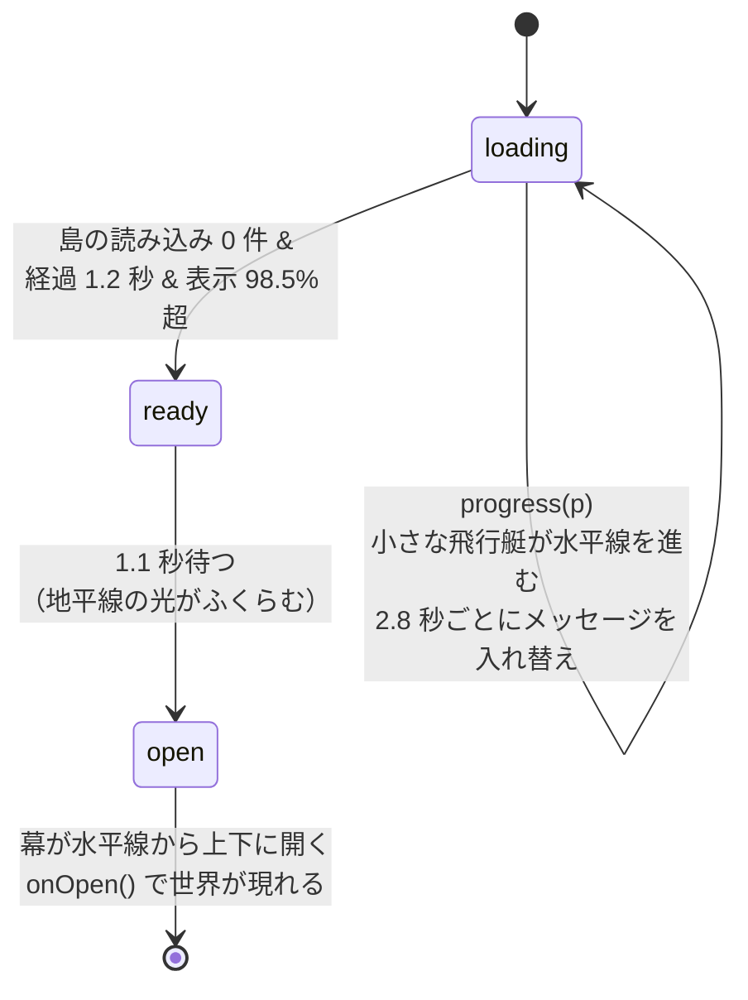

# 10. UI・ローディング・性能

[← 前へ：生きている世界](09-world-life.md) ｜ [目次](README.md)

関係するファイル：`index.html`、`src/ui/ui.ts`、`src/ui/loader.ts`、`src/main.ts`

## 控えめな UI

「世界そのものがインターフェース」という考えで、操作 UI はふだん見えません。マウスを動かすと左下にすりガラス風の帯がふわっと現れ、しばらく操作がないと消えます。

| 操作                              | キー                      | 内容                         |
| --------------------------------- | ------------------------- | ---------------------------- |
| 移ろい / 朝 / 昼 / 光芒 / 夕 / 夜 | `0`〜`5`                  | 時間帯と空模様               |
| 標準 / シネマ                     | `C`                       | カメラモード                 |
| フォトモード                      | `P`（終了は `P` / `Esc`） | 世界を止めて自由に構図を作る |
| 撮影                              | `Space`（フォトモード中） | PNG で保存                   |
| 全画面                            | `F`                       |                              |
| UI の表示/非表示                  | `H`                       |                              |
| 見回す / 距離                     | ドラッグ / ホイール       | 数秒で映画的なカメラに戻る   |

UI は DOM と CSS だけで作っており、three.js とは独立しています。シネマモードの黒帯も CSS で、`body.cinema` クラスが付くと `height: calc((100vh − 100vw / 2.39) / 2)` へ 1.4 秒かけて伸びます。

## ローディングの演出

起動直後、three.js がシェーダをコンパイルし、Worker が周囲の島を作っている間は、`index.html` に直接書かれた **夜の水平線** が表示されます。JavaScript が重い処理をしていても止まらないよう、星のまたたき・水平線を走る光・機体の上下動はすべて CSS アニメーションです。



- 進捗は「初回フレーム 20% → 45% → 島の残り件数に応じて 100%」。表示値は `damp` で追いかけるので、一気に飛ばない
- メッセージは「海図をひろげています」「島々を描いています」「雲を浮かべています」「風を待っています」
- 開くときは CSS の `@property --open` をアニメーションさせた `mask-image` のグラデーションで、**水平線から夜明けが広がるように** 幕が上下に割れる
- 同時に世界側では露出を 2.8 倍から戻し、黒からフェードイン（`pipeline.fade`）して「目が慣れていく」感覚を出す
- `prefers-reduced-motion` のときは装飾アニメーションを止める

## 性能のための工夫

リアルタイムで重い処理（雲のレイマーチ、FFT、大量の木）を、ブラウザで滑らかに動かすための工夫をまとめます。

| 工夫                                  | 場所                 | 効果                                                                           |
| ------------------------------------- | -------------------- | ------------------------------------------------------------------------------ |
| 雲は半解像度 + 時間方向の蓄積         | Pipeline             | 最も重いパスのピクセル数が 1/4。ステップ数の少なさによるノイズはヒストリで消す |
| 空の散乱は 256×128 の LUT に 1 回だけ | Pipeline             | 空・海・霧が毎ピクセル積分しなくて済む                                         |
| 雲の影は 1 枚のマップを共有           | Pipeline             | 海・島・機体・鳥・光芒が雲を個別にマーチしない                                 |
| 雲の空振りスキップと早期終了          | clouds.ts            | 晴れた部分、厚い雲の奥を計算しない                                             |
| 近くだけ細部ノイズ                    | clouds.ts            | 9 km より遠くは 3D ノイズを 1 回だけ                                           |
| FFT は 2 カスケードを 1 回の変換で    | oceanFFT.ts          | RGBA の xy / zw に詰める                                                       |
| 海のメッシュは等比グリッド            | ocean.ts             | 画面上の三角形の大きさがほぼ均一                                               |
| 島の生成は Worker + Transferable      | islands/             | メインスレッドが止まらない、コピーなし                                         |
| 島は LOD 2 段、小物は近くだけ         | manager.ts           | 遠くの島は 1/16 の頂点数                                                       |
| 木・家・鳥は InstancedMesh            | manager.ts, birds.ts | 数千本の木も 1 ドローコール                                                    |
| 夜の灯りは 1 つの Points              | nightLights.ts       | 何百もの灯りが 1 ドローコール                                                  |
| PMREM は 2 秒ごと                     | main.ts              | 環境マップの再生成は重いので間引く                                             |
| デバイスピクセル比は最大 1.5          | main.ts              | Retina でも描画ピクセル数を抑える                                              |

### 適応解像度

フレーム時間の移動平均を見て、描画解像度を自動で上下させます。

```ts
frameAvg = frameAvg * 0.95 + rawDt * 1000 * 0.05; // 指数移動平均（ms）
if (frameAvg > 21 && renderScale > 0.55) {
  // 約 48 fps を下回ったら
  renderScale = Math.max(0.55, renderScale - 0.1); // 10% 下げて 2.5 秒様子を見る
} else if (frameAvg < 13 && renderScale < 1) {
  // 約 77 fps を超えたら
  renderScale = Math.min(1, renderScale + 0.05); // 5% 上げて 4 秒様子を見る
}
```

下げるときは大きく速く、上げるときは小さくゆっくり、というヒステリシスで、解像度が行ったり来たりしないようにしています。

> **リサイズで一瞬黒くなる問題への対策**（コミット `3c2d486`）：キャンバスのサイズを変えると描画バッファが消去されます。描画と表示の間にリサイズが入ると黒いフレームが出てしまうため、`resize()` はフラグを立てるだけにして、実際の適用は **次のフレームの描画直前** に行っています。

## 開発・デバッグのヒント

開発サーバーでは `window.__world` に主要なオブジェクトが公開されています（`time`, `pilot`, `director`, `islands`, `pipeline`, `weather`, `renderer`, `boats`, `ocean`, `birds`, `traffic`）。ブラウザのコンソールから試せる例です。

```js
__world.time.setMode("evening"); // 夕方へ
__world.director.setMode("cinema");
__world.director.cinema.force("cockpit"); // 特定のカットへ
__world.director.holdShot({ yaw: 0.6, lookUp: 25 }, 60); // 標準カメラの構図を 60 秒固定
__world.islands.loading; // 生成待ちの島の数
```

URL パラメーター `?instant`（演出を省略）、`?t=17.5`（開始時刻）、`?scale=1`（解像度固定）と組み合わせると、見た目の確認やスクリーンショットの撮影が楽になります。このドキュメントの画像もこの方法で撮影しました。

---

[← 前へ：生きている世界](09-world-life.md) ｜ [目次](README.md)
